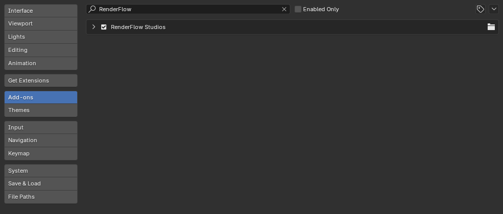
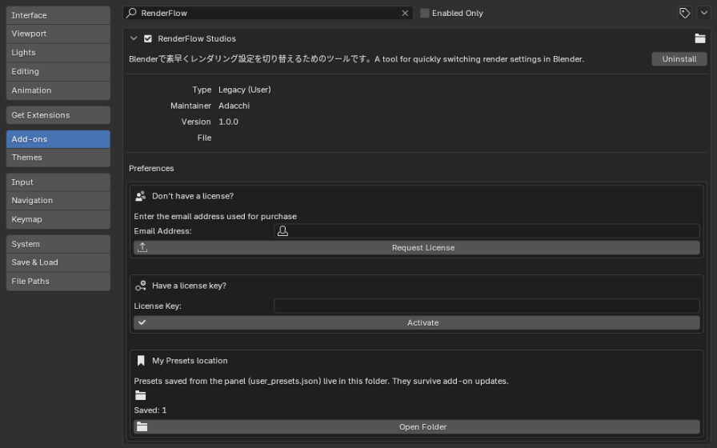
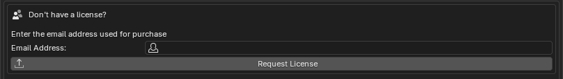
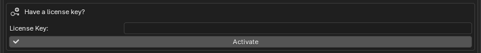
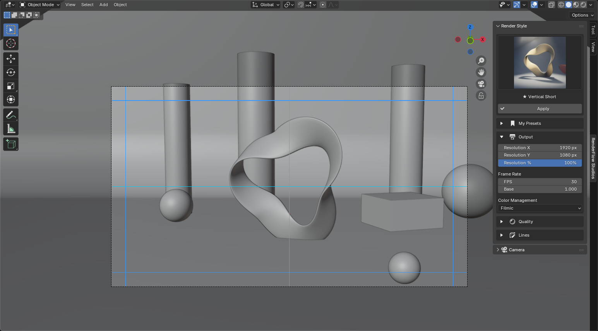

# License Activation

RenderFlow Studios is unlocked with a **license key** issued per purchaser.
Activation is done in Preferences > Add-ons > RenderFlow Studios.

## Opening the settings

1. Open **Edit > Preferences** and choose **Add-ons** in the left menu.
2. Type `RenderFlow` in the search box and click the **▸** to the left of **RenderFlow Studios** to expand it.

{ .ui }

The license settings appear below the add-on entry:

{ .ui }

The upper box is for **requesting** a license, the middle box for **activating** with a key. First-time users go top to bottom. The bottom box, **My Presets location**, is unrelated to activation — it is for backing up [My Presets](my_presets.md).

## Don't have a key yet? (Request)

{ .ui }

1. Enter the **email address** you used for purchase.
2. Click **Request License**, confirm the address in the dialog and press OK.
3. "Request sent! A confirmation email has been sent." means the request succeeded.
4. After approval, the license key is emailed to that address.

!!! warning "If the request fails"
    "The add-on key has been updated. Please download and install the latest add-on." means you are using an old ZIP. Reinstall the latest version and request again.

## Have a key? (Activate)

{ .ui }

1. Paste the key into the **License Key** field.
2. Click **Verify**.
3. "Verified! Panels are now enabled." appears and the **RenderFlow Studios** tab is added to the 3D Viewport sidebar.

{ .ui }

## After activation

- The result is cached per machine, so you stay activated across restarts.
- The cache is checked at startup, so the add-on **works offline**.
- The key is re-checked against the server periodically in the background. A failed check does not immediately disable the add-on.

## Error messages

| Message | Cause | What to do |
|---|---|---|
| Invalid license key | Typo, or a key for another product | Copy the key again from the email |
| License has expired | Time-limited license expired | Renew your license |
| License has been revoked | Refund, terms violation, etc. | Contact support |
| Activation limit reached | Too many machines registered | Ask support to release unused machines |
| Cannot reach the license server | No network, proxy or firewall | Check the connection and retry. Already-activated machines keep working from cache |

!!! note "Machines per license"
    You can normally use one license on several machines you own (e.g. desktop and laptop). If you hit the limit, contact us via [Help](help.md).
