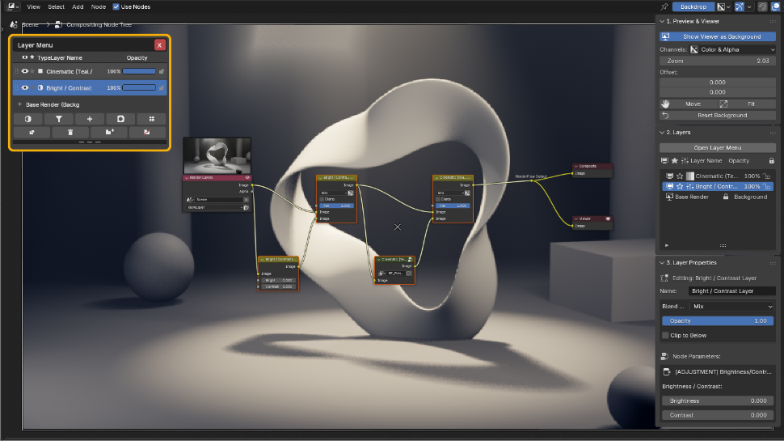
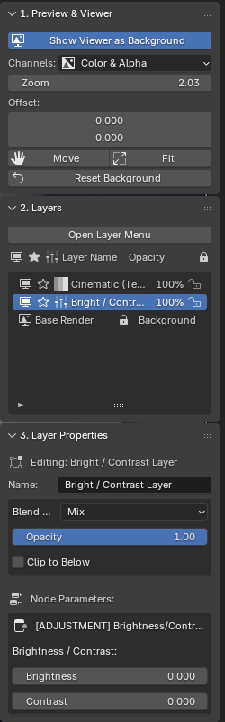

# Adjustment Layers

Add with **Add Layer → Add Adjustment Layer**. These layers correct color and brightness; the type can be switched in Layer Properties afterwards. In each card the left image is before, the right is after (one layer added on its own to the sample scene).

{ .ui }

Pick the type from **Add Adjustment**, the left-most button in the bottom row of the layer menu (HUD). See [Parts of the layer menu](compositor.md#hud) for every button. The layer's parameters appear under **Node Parameters** in Layer Properties.

{ .ui }

## Adjustment types

<b>Bright / Contrast</b> — Overall brightness and contrast

<figure markdown="span">

<figcaption>Before</figcaption>
</figure>
<figure markdown="span">

<figcaption>After</figcaption>
</figure>

Blender node: Bright/Contrast

Parameters: Bright, Contrast

Example settings: Bright 20 / Contrast 45

<b>Exposure</b> — Brightens or darkens the whole image in EV stops, like camera exposure

<figure markdown="span">

<figcaption>Before</figcaption>
</figure>
<figure markdown="span">

<figcaption>After</figcaption>
</figure>

Blender node: Exposure

Parameters: Exposure (EV; +1 doubles the brightness)

Example settings: Exposure +1.0

<b>Color Balance</b> — Tints shadows, midtones and highlights separately

<figure markdown="span">

<figcaption>Before</figcaption>
</figure>
<figure markdown="span">

<figcaption>After</figcaption>
</figure>

Blender node: Color Balance (Lift / Gamma / Gain)

Parameters: Lift (shadows), Gamma (midtones), Gain (highlights)

Example settings: Lift (0.95, 0.97, 1.08) for blue shadows / Gain (1.15, 1.02, 0.85) for orange highlights

<b>RGB Curves</b> — Shape the tonal curve freely; an S-curve adds contrast

<figure markdown="span">

<figcaption>Before</figcaption>
</figure>
<figure markdown="span">

<figcaption>After</figcaption>
</figure>

Blender node: RGB Curves

Parameters: curve editor (C = all, R / G / B = per channel)

Example settings: S-curve with points (0.25, 0.18) and (0.75, 0.85) on the C curve

<b>Hue / Saturation</b> — Rotates hue and adjusts saturation and value

<figure markdown="span">

<figcaption>Before</figcaption>
</figure>
<figure markdown="span">

<figcaption>After</figcaption>
</figure>

Blender node: Hue/Saturation/Value

Parameters: Hue (0.5 = unchanged), Saturation (0 = monochrome), Value

Example settings: Hue 0.62 / Saturation 1.4

<b>Gamma</b> — Lifts or sinks the midtones only

<figure markdown="span">

<figcaption>Before</figcaption>
</figure>
<figure markdown="span">

<figcaption>After</figcaption>
</figure>

Blender node: Gamma

Parameters: Gamma (below 1 brightens, above 1 darkens)

Example settings: Gamma 1.8

## Tips

- An adjustment affects **every layer below it**. To limit it to an area, see [Masks & Clipping](masks.md).
- Rough in with exposure and color balance, then refine with RGB curves.
- Lowering opacity weakens the effect faster than dialing back parameters.
