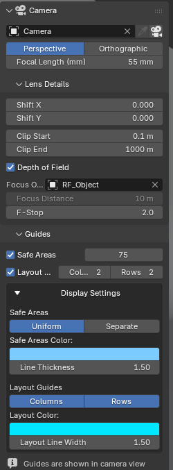

# Camera

3D Viewport sidebar → **RenderFlow Studio** tab → **Camera** panel.
Camera selection and lens settings in one place.

{ .ui }

## Selecting the camera

| UI | Action |
|---|---|
| Camera dropdown | Switches the scene camera (`Scene > Camera`) |
| :material-eyedropper: Eyedropper | Makes the camera object selected in the 3D Viewport the scene camera |
| :material-camera: Camera View | Toggles the viewport camera view (++numpad0++) |

!!! note "Which camera is edited"
    The panel targets, in order: the camera shown in the 3D Viewport → the scene camera → the selected camera → the first camera in the scene. Normally that is the scene camera.

## Projection and lens

| Item | Description |
|---|---|
| Perspective / Orthographic | Projection type. The 1980s presets use orthographic |
| Focal Length (mm) | Shown for perspective. If the camera's lens unit is "Field of View", the angle is shown instead |
| Ortho Scale | Shown for orthographic |

## Lens Details (sub-panel)

Closed by default; click to expand.

| Item | Description |
|---|---|
| Shift X / Y | Lens shift for perspective correction and framing |
| Clip Start / End | Visible distance range. Rewritten when a render style is applied |
| Depth of Field | When on, focus object, focus distance and F-stop appear. Focus distance is disabled while a focus object is set |

## Guides (sub-panel)

Safe area and layout guide settings, stored per camera.
→ [Guides (Safe Area)](camera_guides.md)
