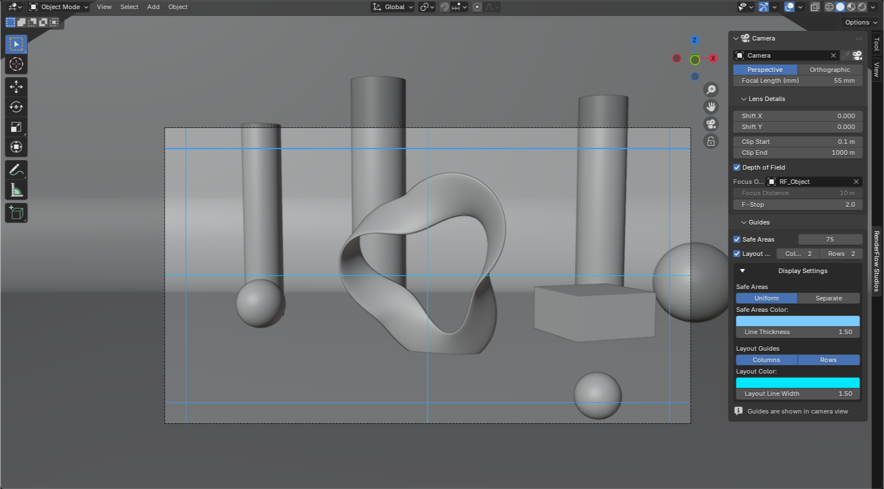

# Guides (Safe Area)

The **Guides** sub-panel inside the **Camera** panel. Overlays safe areas and layout guides in camera view.

{ .ui }

!!! info "Stored per camera"
    Guide settings live on the camera data (`bpy.types.Camera`). Camera A for cinemascope and camera B for vertical shorts can each have their own safe area. Linked-duplicate cameras share the settings.

## Safe Areas

| Item | Description |
|---|---|
| ☐ Safe Areas | Toggle the overlay |
| Margin (px) | In **render-resolution pixels**. 50 px at Full HD is about 2.6% of the width |

The margin is overwritten by the preset's `safe area px` when a render style is applied (Cinema = 75 px, 1980s Early = 8 px, etc.).

## Layout Guides

| Item | Description |
|---|---|
| ☐ Layout Guides | Toggle the grid lines |
| Columns / Rows | Number of divisions (2–100). 3×3 gives the rule of thirds |

## Display Settings (collapsible)

| Item | Description |
|---|---|
| Safe Areas: Uniform / Separate | Separate lets you set different left-right and top-bottom margins (e.g. extra room at the bottom for subtitles) |
| Safe Areas Color / Line Thickness | |
| Layout: Columns / Rows enable | Show only columns or only rows |
| Layout Color / Line Width | |

!!! tip "Guides are only drawn in camera view"
    Nothing is drawn in a normal view. If the panel says "Guides are shown in camera view", press ++numpad0++. Guides are viewport-only and never appear in renders.
