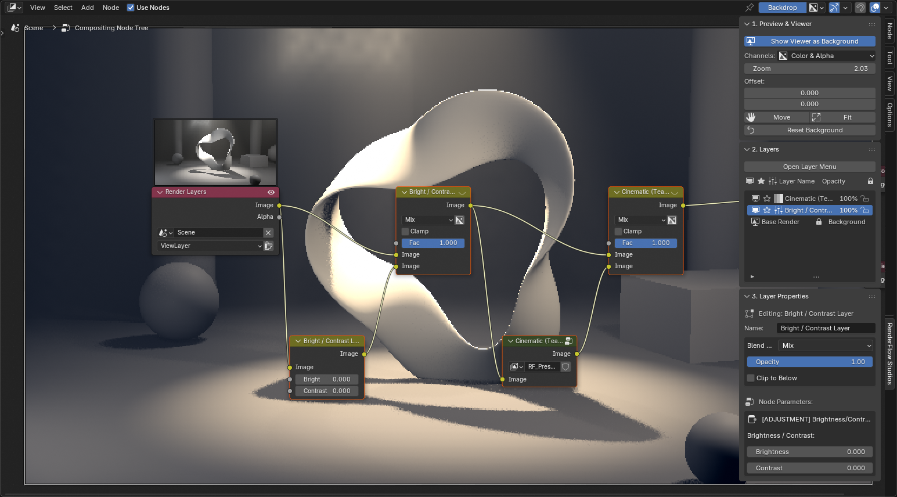
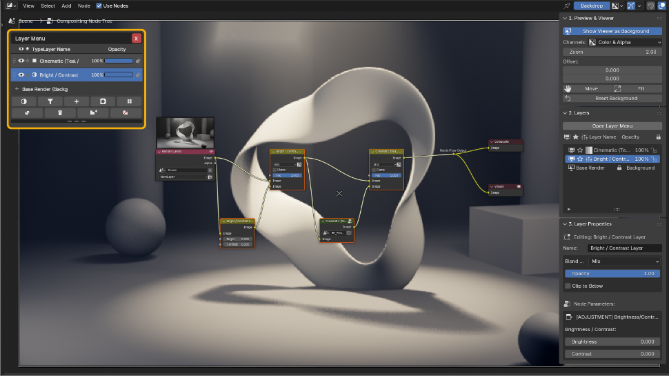
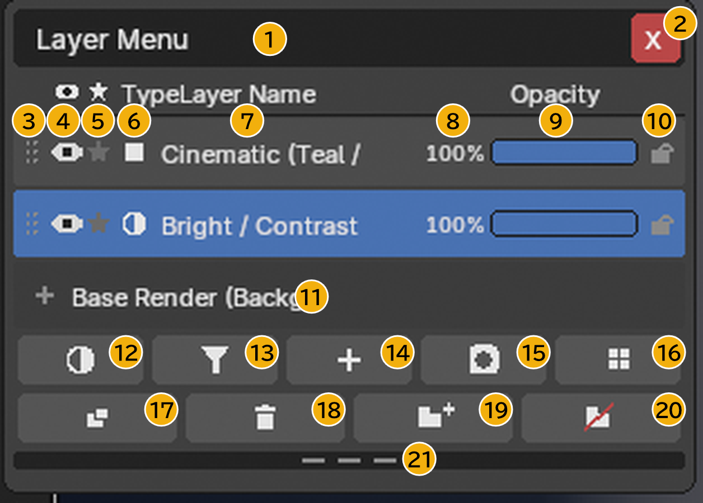

# Compositor Layers

Compositor (Node Editor) sidebar → **RenderFlow Studios** tab.
Operate Blender's node compositor as **layers**, like Photoshop or After Effects.

{ .ui }

!!! abstract "How it works"
    Nodes are the implementation; layers are the interface. Adding a layer creates one `MixRGB` node, chained Render Layers → Mix → Mix → … → Composite. You may edit nodes directly; if the layer list gets out of sync, run **Sync UI to Nodes**.

## The three panels

### 1. Preview & Viewer
- Connects the result to a Viewer node and shows it as the backdrop.
- **Move / Fit / Reset Background**: backdrop zoom and offset
- **Before / After**: compare with and without layers

### 2. Layers
- The layer stack; top is front.
- **Add Layer** menu: Input / Adjustment / Filter / Preset / Mask
- Drag rows to reorder (layer HUD), **Duplicate**, **Remove**, **Solo**
- **New Group / Ungroup**, **Rename Layer**

{ .ui }

Press **Open Layer Menu** to overlay the layer menu (HUD) on the editor. Adding, duplicating, removing and grouping layers all happen here. See [Parts of the layer menu](#hud) below for every control.

### 3. Layer Properties
Settings for the selected layer.

| Item | Description |
|---|---|
| Opacity | 0–1 |
| Blend mode | Mix / Darken / Multiply / Color Burn / Lighten / Screen / Color Dodge / Add / Overlay / Soft Light / Linear Light / Difference / Exclusion / Subtract / Divide / Hue / Saturation / Color / Value |
| Type-specific | Adjustment type, FX parameters, input source, mask shape, etc. |
| Clipping | Apply only within the layer directly below |

## Parts of the layer menu (HUD) { #hud }

{ .ui }

| No. | Item | Description |
|---|---|---|
| ① | Title bar | Drag to move the HUD anywhere in the editor. |
| ② | Close (×) | Closes the HUD. **Esc** also closes it. |
| ③ | Drag handle | Drag here (or an empty part of the row) up or down to reorder layers, including into or out of a group. |
| ④ | Visibility (eye) | Shows or hides the layer. Hidden layers do not affect the result. |
| ⑤ | Solo (★) | Shows **only** this layer and temporarily disables the others. Click again to release. |
| ⑥ | Type icon | The layer type: adjustment / filter / input / mask / preset / group. |
| ⑦ | Layer name | Click to select; **double-click** to open the rename dialog. |
| ⑧ | Opacity (value) | Click to type a value directly (0–100). |
| ⑨ | Opacity slider | Drag to change opacity. With several layers selected, all of them change together. |
| ⑩ | Lock | When on, the opacity cannot be changed and the row cannot be dragged. |
| ⑪ | Base Render (background) | The bottom-most base (Render Layers). It cannot be moved or removed. |
| ⑫ | Add Adjustment | Adds Bright/Contrast, Exposure, Color Balance, RGB Curves, Hue/Saturation or Gamma. → [Adjustment Layers](adjustment.md) |
| ⑬ | Add Filter | Adds an FX filter from the asset library. → [FX Filter Library](fx_filters.md) |
| ⑭ | Add Input | Adds Scene (Render Layer), Image, Image Sequence or Movie Clip. |
| ⑮ | Add Mask | Adds an Ellipse, Box, Double Edge or Paint mask. → [Masks & Clipping](masks.md) |
| ⑯ | Add Preset | Adds one of the nine Look presets such as Cinematic. → [Look Presets](look_presets.md) |
| ⑰ | Duplicate | Duplicates the selected layer. |
| ⑱ | Remove | Removes the selected layer. |
| ⑲ | New Group | Groups the selected layers. Collapse a group with ▸ and toggle it as a whole with its eye icon. |
| ⑳ | Ungroup | Dissolves the selected group and restores its layers. |
| ㉑ | Resize handle | Drag up or down to change how many rows are shown; scroll with the mouse wheel when there are more. |

!!! tip "Ordering"
    Higher rows are applied **later** (in front). An adjustment affects every layer below it, so put global corrections at the top, and place a layer-specific adjustment directly above its target with clipping on.

## Basic workflow

1. **Add Layer → Input → Scene (Render Layer)** as the base (added automatically the first time).
2. **Add Adjustment Layer** for color and exposure. → [Adjustment Layers](adjustment.md)
3. **Add Filter** or **Add Preset** for texture. → [FX Filter Library](fx_filters.md) / [Look Presets](look_presets.md)
4. To limit an effect, **Add Mask** and enable clipping. → [Masks & Clipping](masks.md)
5. Tune with opacity and check with Before / After.

!!! warning "Filters with Film Transparent off"
    Some filters (those using transparency) do nothing while Render > Film > Transparent is off. When the panel warns, use the **Enable Film Transparent** button.
