# FX Filter Library

Choose from **Add Layer → Add Filter**. In each card the left image is before, the right is after. All examples use the same source image with default parameters.

!!! info "Setup required"
    Filters other than Blur become available once the bundled `FX_filters.blend` is registered as an asset library. → [Install › 4. Register the FX filter asset library](install.md#4-register-the-fx-filter-asset-library)
    A filter is appended into your `.blend` on first use; after that the node group inside the file is used.

## FX1 Basic

<b>Blur</b> — Gaussian blur

<figure markdown="span">

<figcaption>Before</figcaption>
</figure>
<figure markdown="span">
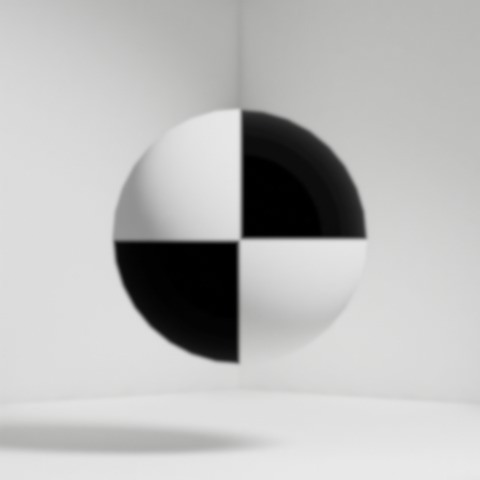
<figcaption>After</figcaption>
</figure>

Parameters: Size (X = Y)

<b>Sharpen</b> — Edge enhancement

<figure markdown="span">

<figcaption>Before</figcaption>
</figure>
<figure markdown="span">
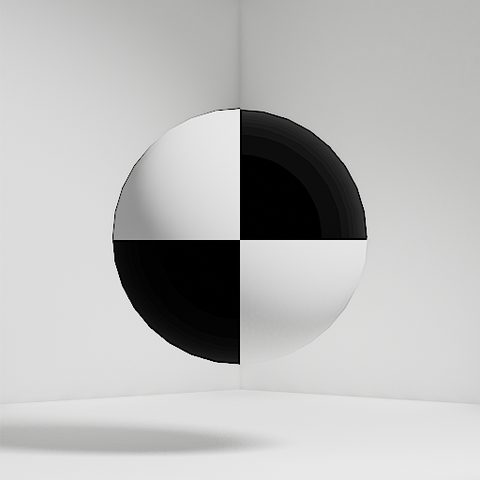
<figcaption>After</figcaption>
</figure>

Parameters: Strength

<b>Glow</b> — Bloom on highlights

<figure markdown="span">

<figcaption>Before</figcaption>
</figure>
<figure markdown="span">
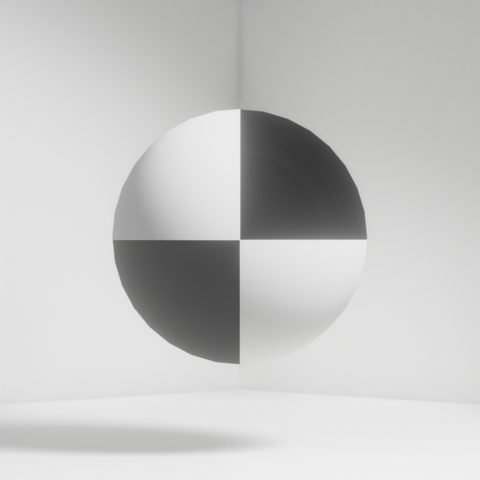
<figcaption>After</figcaption>
</figure>

Parameters: Threshold, size, strength

<b>Edge Detect</b> — Edge extraction

<figure markdown="span">

<figcaption>Before</figcaption>
</figure>
<figure markdown="span">
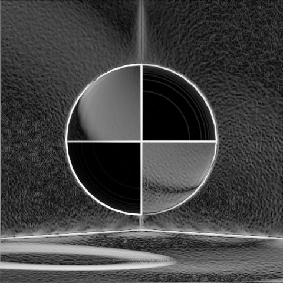
<figcaption>After</figcaption>
</figure>

Parameters: Strength, mix

<b>Noise</b> — Grain

<figure markdown="span">

<figcaption>Before</figcaption>
</figure>
<figure markdown="span">
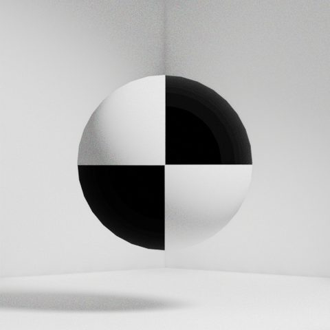
<figcaption>After</figcaption>
</figure>

Parameters: Texture type, mix, strength

## FX2 Optical

<b>Chromatic Aberration</b> — Color fringing

<figure markdown="span">

<figcaption>Before</figcaption>
</figure>
<figure markdown="span">
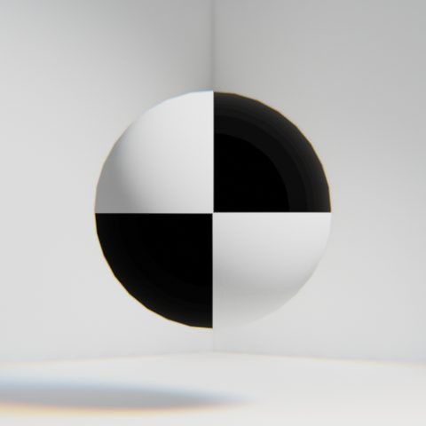
<figcaption>After</figcaption>
</figure>

Parameters: Amount

<b>Lens Blur Z</b> — Depth of field from the Z pass

<figure markdown="span">

<figcaption>Before</figcaption>
</figure>
<figure markdown="span">
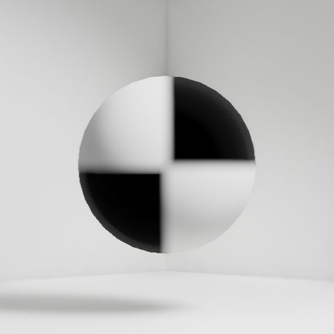
<figcaption>After</figcaption>
</figure>

Parameters: F-stop, max blur, normalize Z

<b>Motion Blur</b> — Directional blur

<figure markdown="span">

<figcaption>Before</figcaption>
</figure>
<figure markdown="span">
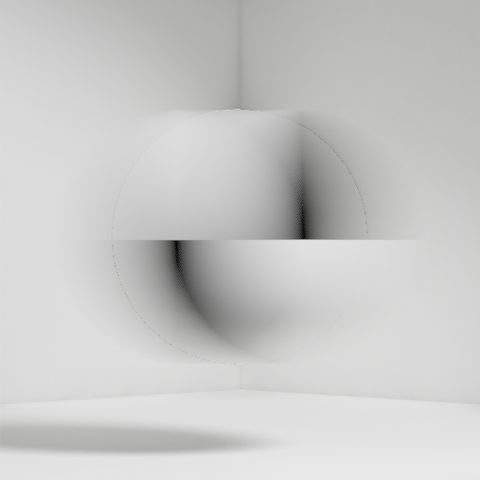
<figcaption>After</figcaption>
</figure>

Parameters: Angle, distance

<b>Vignette</b> — Edge darkening

<figure markdown="span">

<figcaption>Before</figcaption>
</figure>
<figure markdown="span">
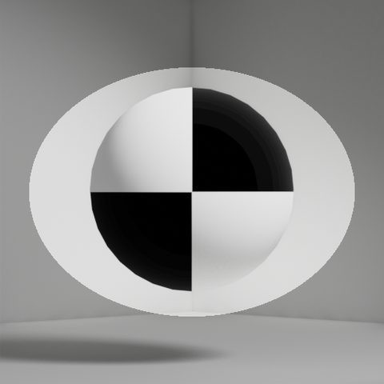
<figcaption>After</figcaption>
</figure>

Parameters: Width, height, blur, rotation

<b>Fisheye</b> — Lens distortion

<figure markdown="span">

<figcaption>Before</figcaption>
</figure>
<figure markdown="span">
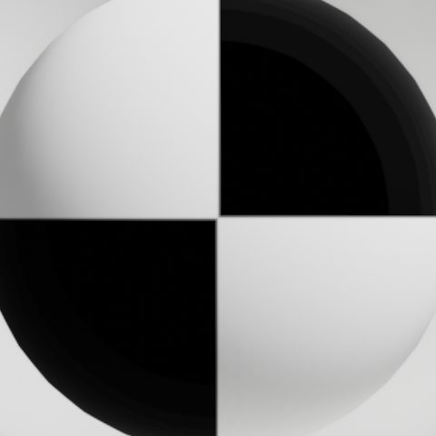
<figcaption>After</figcaption>
</figure>

Parameters: Amount

## FX3 Color

<b>Sepia</b> — Faded brown tone

<figure markdown="span">

<figcaption>Before</figcaption>
</figure>
<figure markdown="span">
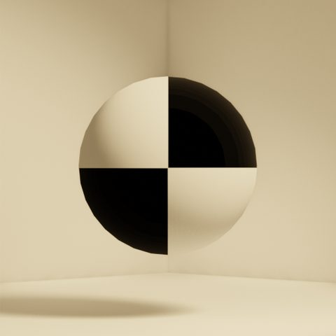
<figcaption>After</figcaption>
</figure>

<b>Neon</b> — High-saturation glow

<figure markdown="span">

<figcaption>Before</figcaption>
</figure>
<figure markdown="span">
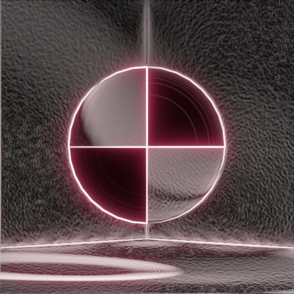
<figcaption>After</figcaption>
</figure>

## FX4 NPR

<b>Comic</b> — Posterized tones + outlines

<figure markdown="span">

<figcaption>Before</figcaption>
</figure>
<figure markdown="span">
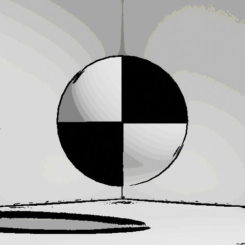
<figcaption>After</figcaption>
</figure>

<b>Silhouette</b> — Flat shadow-play look

<figure markdown="span">

<figcaption>Before</figcaption>
</figure>
<figure markdown="span">
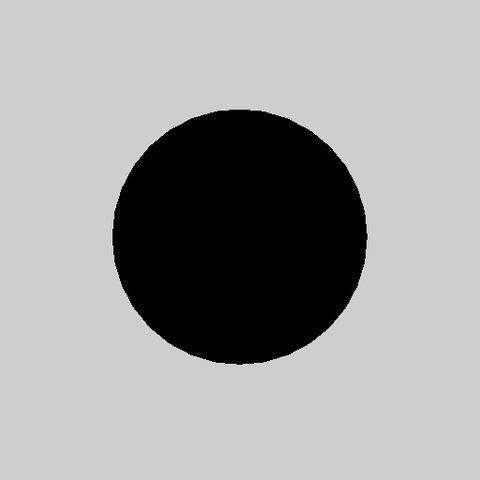
<figcaption>After</figcaption>
</figure>

<b>Watercolor</b> — Bleeding and paper texture

<figure markdown="span">

<figcaption>Before</figcaption>
</figure>
<figure markdown="span">
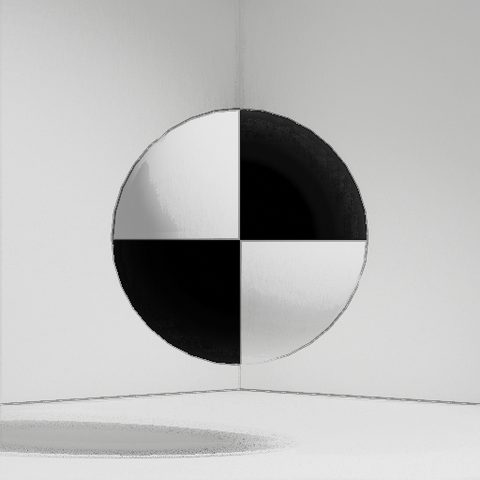
<figcaption>After</figcaption>
</figure>

<b>Watercolor 2</b> — Stronger paper grain

<figure markdown="span">

<figcaption>Before</figcaption>
</figure>
<figure markdown="span">
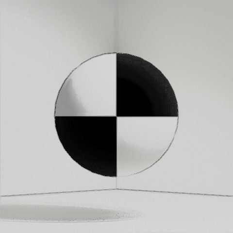
<figcaption>After</figcaption>
</figure>

<b>Oil Painting</b> — Thick brush strokes

<figure markdown="span">

<figcaption>Before</figcaption>
</figure>
<figure markdown="span">
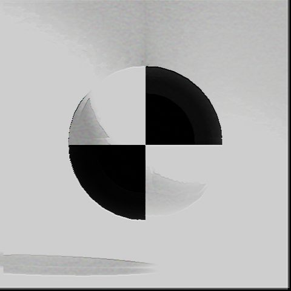
<figcaption>After</figcaption>
</figure>

<b>Stipple</b> — Dot-based rendering

<figure markdown="span">

<figcaption>Before</figcaption>
</figure>
<figure markdown="span">
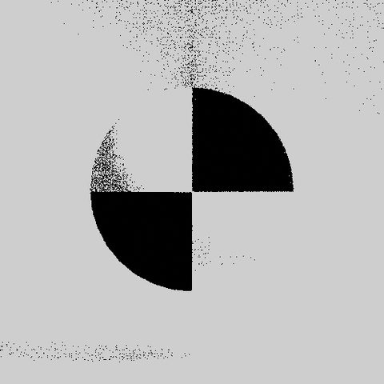
<figcaption>After</figcaption>
</figure>

<b>Line Art</b> — Outlines only

<figure markdown="span">

<figcaption>Before</figcaption>
</figure>
<figure markdown="span">
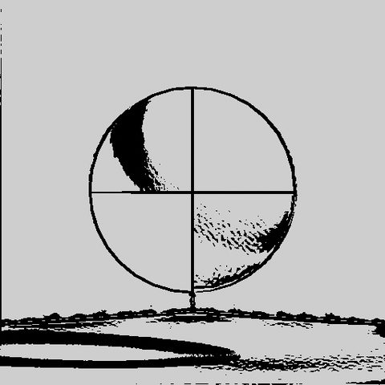
<figcaption>After</figcaption>
</figure>

<b>Line Art 2</b> — Thicker lines

<figure markdown="span">

<figcaption>Before</figcaption>
</figure>
<figure markdown="span">
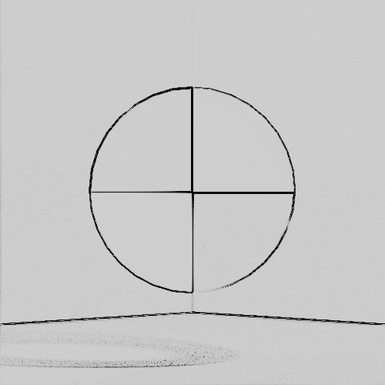
<figcaption>After</figcaption>
</figure>

## FX5 Retro

<b>8bit</b> — Reduced palette + pixelation

<figure markdown="span">

<figcaption>Before</figcaption>
</figure>
<figure markdown="span">
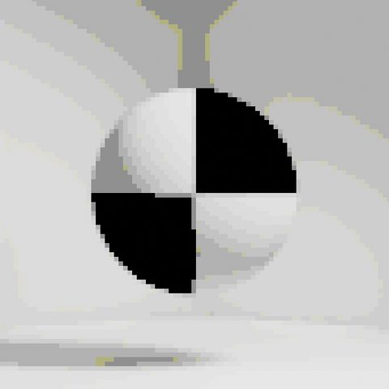
<figcaption>After</figcaption>
</figure>

<b>8bit LCD</b> — Handheld LCD look (4 green tones)

<figure markdown="span">

<figcaption>Before</figcaption>
</figure>
<figure markdown="span">
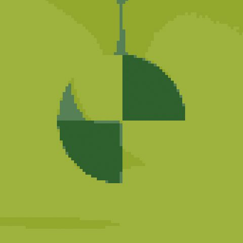
<figcaption>After</figcaption>
</figure>

<b>16bit</b> — 16-bit console palette

<figure markdown="span">

<figcaption>Before</figcaption>
</figure>
<figure markdown="span">
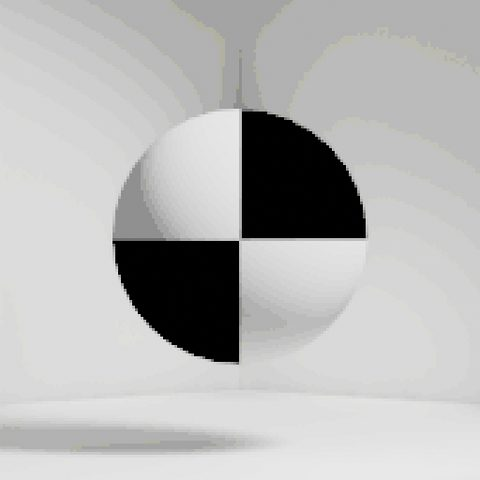
<figcaption>After</figcaption>
</figure>

!!! tip "Combine with render styles"
    Render with "1990s-A" and add the FX5 16bit filter to match both resolution and palette.
