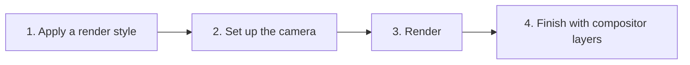
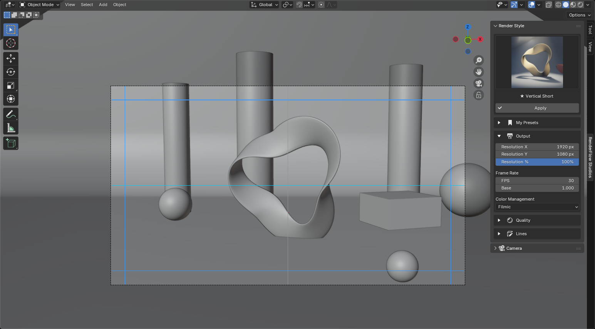

# Guide

RenderFlow Studio follows four steps.

## Where the panels are

| Feature | Editor | Location |
|---|---|---|
| Render Style / Camera | 3D Viewport | Sidebar (++n++) → **RenderFlow Studio** tab |
| Compositor Layers | Compositor (Node Editor) | Sidebar (++n++) → **RenderFlow Studios** tab |
| Mask painting | Image Editor | Sidebar → **RenderFlow Studios** tab |

{ .ui }

## 1. Apply a render style

In the **Render Style** panel, click an icon and press **Apply**.
Engine, resolution, samples, fps, color management and camera projection are set in one go.

→ [Render Style](render_style.md)

## 2. Set up the camera

Pick the scene camera in the **Camera** panel and adjust focal length and depth of field.
Turn on safe areas in the **Guides** sub-panel to frame with title-safe regions visible.

→ [Camera](camera.md) / [Guides (Safe Area)](camera_guides.md)

## 3. Render

Render as usual with ++f12++ (still) or ++ctrl+f12++ (animation).
Set the output format (PNG / video codec) in Blender's standard Output properties.

## 4. Finish with compositor layers

Open the Compositor and use **Add Layer** in the sidebar's **RenderFlow Studios** tab.
Balance colors with adjustment layers, add texture with FX filters or Look presets, and limit effects with masks.

→ [Compositor Layers](compositor.md)

!!! tip "Order matters"
    Applying a render style also rewrites the camera projection (perspective / orthographic), clip range and safe-area margin. Choose the style before fine-tuning the camera to avoid redoing work.
