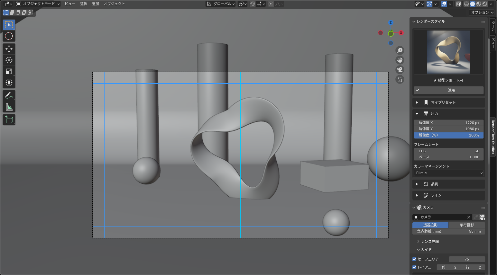

<h1>From render settings to the <em>final look</em>, in one tab.</h1>

RenderFlow Studios is a Blender add-on built for video production. It gathers the whole flow — pick render settings → set up the camera → render → finish — into one sidebar tab and a layer-based compositor.

Blender 4.5 LTS recommendedWorks on 4.0+EEVEE / CyclesEnglish / 日本語 UI

[Installation](install.md){ .md-button .md-button--primary } [Read the guide](guide.md){ .md-button }

<figure markdown style="margin:0">

BeforeAfter
<input type="range" min="0" max="100" value="50" aria-label="Slider comparing before and after">

<figcaption>Drag the slider to compare. Left: the plain render. Right: the same render with one compositor layer — the Look preset "Cinematic (Teal / Orange)" (sample scene).</figcaption>
</figure>

<b>5</b>Render styles

<b>22</b>FX filters

<b>9</b>Look presets

<b>4<small> steps</small></b>Settings to final look

## <i class="bi bi-info-circle-fill"></i> Overview

RenderFlow Studios turns "settings → shooting → finishing" in Blender into one continuous flow. Switch a complete set of render settings in one click — from 80s / 90s retro to cinematic — frame your shot with the camera and safe areas in the sidebar, then finish the render by stacking layers. No hand-built node trees required.

## <i class="bi bi-stars"></i> Features

<i class="bi bi-film ms-feat-ic" aria-hidden="true"></i><b>Render Style</b>
**All the settings in one click**

Engine, resolution, samples, fps and color management switch together, from retro to cinematic. → [Render Style](render_style.md)

<i class="bi bi-bookmark-star-fill ms-feat-ic" aria-hidden="true"></i><b>My Presets</b>
**Keep your own settings**

Save tuned settings under a name and pick them from the same grid as the built-in styles. → [My Presets](my_presets.md)

<i class="bi bi-camera-reels-fill ms-feat-ic" aria-hidden="true"></i><b>Camera</b>
**Camera control for video**

Pick the camera, set the lens and depth of field, and switch the projection — all from the sidebar. → [Camera](camera.md)

<i class="bi bi-bounding-box ms-feat-ic" aria-hidden="true"></i><b>Guides</b>
**Safe areas per camera**

Safe areas and layout guides are stored per camera, so a cinemascope camera and a vertical-shorts camera keep their own. → [Guides (Safe Area)](camera_guides.md)

<i class="bi bi-layers-fill ms-feat-ic" aria-hidden="true"></i><b>Compositor Layers</b>
**Finish by stacking layers**

Drag to reorder, opacity, blend modes, groups and before / after comparison — built on Blender's own nodes. → [Compositor Layers](compositor.md)

<i class="bi bi-magic ms-feat-ic" aria-hidden="true"></i><b>FX &amp; Looks</b>
**22 FX filters and 9 Looks**

Optical effects like blur, glow and chromatic aberration; watercolor, oil and line art; 8-bit / 16-bit; cinematic grades. → [FX Filters](fx_filters.md) / [Looks](look_presets.md)

## <i class="bi bi-collection-play-fill"></i> One shot in 4 steps

<figure class="ms-shot" markdown>

<figcaption>3D Viewport sidebar › RenderFlow Studios tab</figcaption>
</figure>

<a href="render_style.html">1<b>Style</b>Pick a render style and apply it. Engine to color, set at once.</a>
<a href="camera.html">2<b>Camera</b>Set the lens and depth of field; frame the shot with safe areas.</a>
<a href="guide.html">3<b>Render</b>As usual: F12 for a still, Ctrl+F12 for an animation.</a>
<a href="compositor.html">4<b>Finish</b>Grade with compositor layers and add texture with FX and Looks.</a>

<!-- Intro video: when the YouTube ID is ready, remove this comment and replace XXXXXXXXXXX
## <i class="bi bi-play-btn-fill"></i> Watch the video

<iframe src="https://www.youtube.com/embed/XXXXXXXXXXX" title="RenderFlow Studios" frameborder="0" allow="accelerometer; autoplay; clipboard-write; encrypted-media; gyroscope; picture-in-picture" allowfullscreen></iframe>

-->

## <i class="bi bi-pc-display"></i> Requirements

| Item | Details |
|---|---|
| Blender | 4.5 LTS (recommended). Works on 4.0 and later |
| OS | Windows 10 / 11, macOS 12 or later, Linux (as supported by Blender) |
| Render engine | EEVEE / Cycles (the cinematic preset uses 512 Cycles samples — GPU rendering recommended) |
| License activation | Internet is needed only to request the key and activate once (works offline afterwards) |

See [Requirements](requirements.md) for details.

## <i class="bi bi-clock-history"></i> Release

| Version | Date | Notes |
|---|---|---|
| v1.0.0-alpha | 2026-09 | Closed alpha for invited testers (first release) |

See [Release Notes](release.md) for the changes.

## <i class="bi bi-file-earmark-text-fill"></i> License

RenderFlow Studios is commercial software. After purchase, follow [License Activation](activation.md) to request and register your key; the activation persists across Blender restarts. The terms of use are in [License](license.md).

## <i class="bi bi-book-fill"></i> How to use these docs

| I want to… | Page |
|---|---|
| Install it / check requirements | [Install](install.md) / [Requirements](requirements.md) |
| Request and activate a license key | [License Activation](activation.md) |
| See the overall workflow | [Guide](guide.md) |
| Switch or save render settings | [Render Style](render_style.md) / [My Presets](my_presets.md) |
| Set up the camera and safe areas | [Camera](camera.md) / [Guides (Safe Area)](camera_guides.md) |
| Finish with layers | [Compositor Layers](compositor.md) / [Layer Types](layer_types.md) |
| Browse filter and grade samples | [FX Filter Library](fx_filters.md) / [Look Presets](look_presets.md) |
| Fix a problem | [Help](help.md) |
