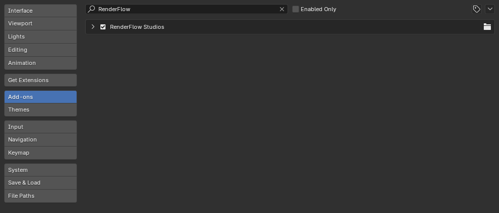
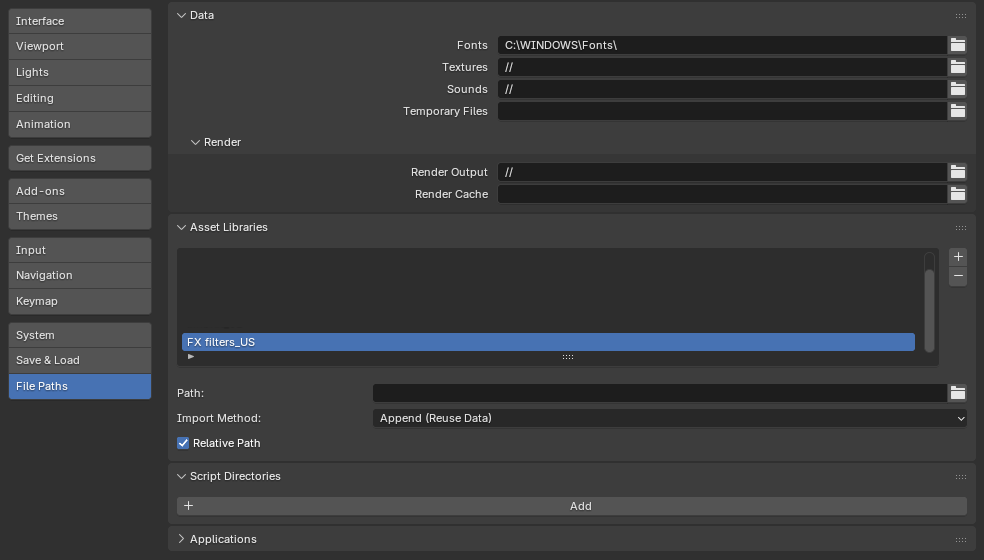

# Install

## 1. Download the ZIP

Download `RenderFlow_Studio_vX.X.X.zip` from the link provided after purchase. **Do not unzip it.**

## 2. Install in Blender

1. Open ++"Edit"++ → ++"Preferences"++ (macOS: ++"Blender"++ → ++"Settings"++).
2. Select the **Add-ons** tab.
3. Click the **∨** menu at the top right → **Install from Disk...** and choose the ZIP.
4. **RenderFlow Studio** appears in the list. Tick the checkbox to enable it.

{ .ui }

## 3. Activate your license

Right after enabling, the add-on preferences show only the license form and no panels are registered yet.
Follow [License Activation](activation.md); once activated, the **RenderFlow Studio** tab appears in the 3D Viewport sidebar.

## 4. Register the FX filter asset library

The compositor **FX filters** (all 21 except Blur) are node groups stored in the bundled `FX_filters.blend`, loaded through Blender's **Asset Library** system. Enabling the add-on alone does not register them, so do this once:

1. Place the bundled `FX filters assets` folder anywhere you like (choose `FX filters_JP` or `FX filters_US` to match your UI language).
2. Open ++"Edit"++ → ++"Preferences"++ → **File Paths** → **Asset Libraries**, click **+** and add that folder.
3. Give the library a name that **contains "FX" or "Filter"** (e.g. `RenderFlow FX`). The add-on uses the name to find the library.

{ .ui }

!!! warning "Libraries without FX / Filter in the name are ignored"
    The name filter prevents scanning huge material libraries by mistake. Once registered, the FX1–FX5 filters appear in the **Add Filter** menu.

## Updating

1. In Preferences > Add-ons, expand RenderFlow Studio and click **Remove**.
2. Restart Blender.
3. Install the new ZIP as above.

!!! tip
    Your license key is stored in Blender's preferences, so you do not need to re-enter it after updating.

## Uninstalling

Expand RenderFlow Studio in Preferences > Add-ons and click **Remove**. The license cache is removed as well.
