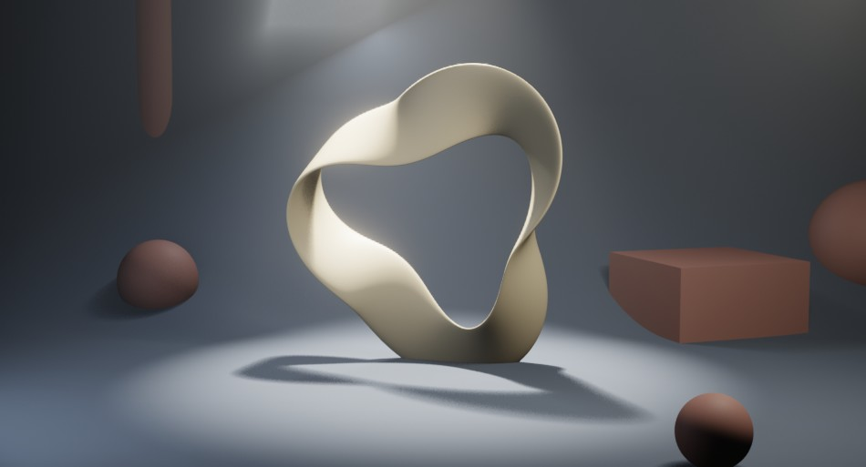
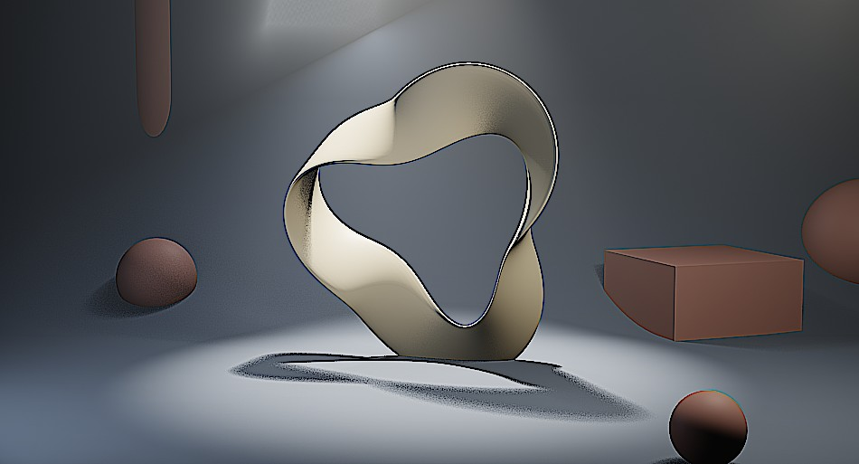

# Look Presets

Choose from **Add Layer → Add Preset**. A node group with several nodes in series is added as one layer, and each node's parameters can be tuned in Layer Properties. In each card the left image is before, the right is after (one preset added on its own to the sample scene with default parameters).

## Looks (color grading)

<b>Cinematic (Teal / Orange)</b> — the classic film look: teal shadows, orange highlights

<figure markdown="span">

<figcaption>Before</figcaption>
</figure>
<figure markdown="span">

<figcaption>After</figcaption>
</figure>

Nodes: Color Balance (teal lift / orange gain) → Hue/Saturation (saturation 1.12)

Good for: general cinematic looks, live-action feel

<b>Warm Sunlight</b> — warm color balance

<figure markdown="span">

<figcaption>Before</figcaption>
</figure>
<figure markdown="span">

<figcaption>After</figcaption>
</figure>

Nodes: Color Balance (gain shifted warm, 1.08 / 1.0 / 0.88)

Good for: sunsets, flashbacks, gentle moods

<b>Cool Moonlight</b> — cool color balance

<figure markdown="span">

<figcaption>Before</figcaption>
</figure>
<figure markdown="span">

<figcaption>After</figcaption>
</figure>

Nodes: Color Balance (gain shifted cool, 0.88 / 0.97 / 1.1)

Good for: night, sci-fi, tense scenes

<b>Vintage Film</b> — adds a yellow cast and lowers saturation and contrast, like old film

<figure markdown="span">

<figcaption>Before</figcaption>
</figure>
<figure markdown="span">

<figcaption>After</figcaption>
</figure>

Nodes: Color Balance (yellowish lift / gain) → Hue/Saturation (saturation 0.8) → Bright/Contrast (contrast −5)

Good for: old footage, archival look, memories

<b>Black & White</b> — monochrome

<figure markdown="span">

<figcaption>Before</figcaption>
</figure>
<figure markdown="span">

<figcaption>After</figcaption>
</figure>

Nodes: Hue/Saturation (saturation 0)

Good for: black-and-white work, memories, dramatic stills

<b>High Contrast</b> — punchy, graphic contrast

<figure markdown="span">

<figcaption>Before</figcaption>
</figure>
<figure markdown="span">

<figcaption>After</figcaption>
</figure>

Nodes: Bright/Contrast (contrast +15)

Good for: graphic looks, poster-like frames

## Filters (texture)

<b>Soft Glow</b> — soft bloom on highlights

<figure markdown="span">

<figcaption>Before</figcaption>
</figure>
<figure markdown="span">

<figcaption>After</figcaption>
</figure>

Nodes: Glare (Fog Glow, medium quality)

Good for: fantasy, dreamy scenes

<b>Dream Blur</b> — gentle overall blur

<figure markdown="span">

<figcaption>Before</figcaption>
</figure>
<figure markdown="span">

<figcaption>After</figcaption>
</figure>

Nodes: Blur (Gaussian, 8 px)

Good for: dreams, memories, flashback transitions

<b>Sharpen</b> — global sharpening

<figure markdown="span">

<figcaption>Before</figcaption>
</figure>
<figure markdown="span">

<figcaption>After</figcaption>
</figure>

Nodes: Filter (Sharpen)

Good for: final polish, before downscaling

!!! note
    A Look preset copies the node setup at the time it is added, so you can edit it freely. To reset, delete the layer and add it again.
