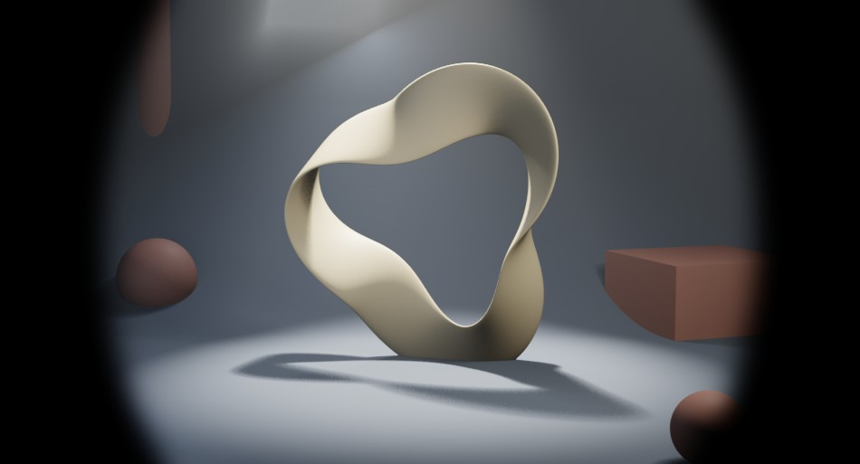
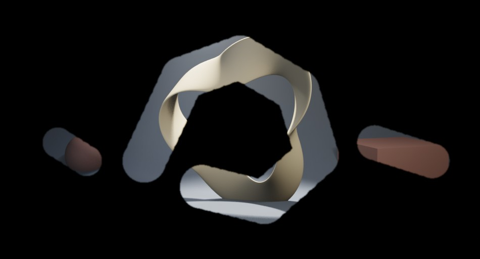
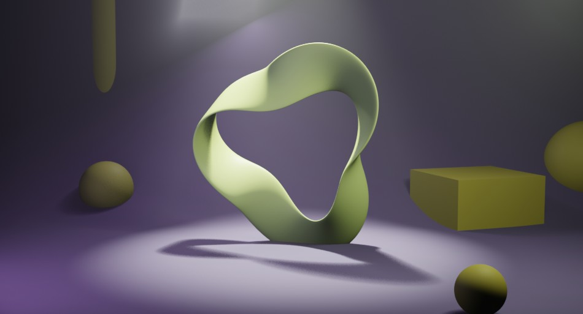

# Masks & Clipping

Keep only part of the frame, or change how strongly an effect applies across the frame. In each card the left image is before, the right is after (rendered from the sample scene).

## Mask layers

Choose from **Add Layer → Add Mask**. Masks are **white = show / black = hide**. A mask layer uses the **Multiply** blend mode by default, so adding one keeps the image below it only where the mask is white and turns the rest black (useful as a vignette or cut-out). Soften the edge with **Mask Blur** in Layer Properties.

<div class="fx-grid" markdown>

<div class="fx-card" markdown>
<div class="fx-title"><b>Ellipse Mask</b> — keeps only an elliptical region</div>
<div class="fx-pair" markdown>
<figure markdown="span">

<figcaption>Before</figcaption>
</figure>
<figure markdown="span">

<figcaption>After</figcaption>
</figure>
</div>
<div class="fx-params">Blender node: Ellipse Mask</div>
<div class="fx-params">Parameters: width, height, rotation, mask blur</div>
<div class="fx-params">Example settings: Width 0.75 / Height 0.9 / Mask Blur 40</div>
</div>

<div class="fx-card" markdown>
<div class="fx-title"><b>Box Mask</b> — keeps only a rectangular region</div>
<div class="fx-pair" markdown>
<figure markdown="span">

<figcaption>Before</figcaption>
</figure>
<figure markdown="span">

<figcaption>After</figcaption>
</figure>
</div>
<div class="fx-params">Blender node: Box Mask</div>
<div class="fx-params">Parameters: width, height, rotation, mask blur</div>
<div class="fx-params">Example settings: Width 0.55 / Height 0.7 / Rotation 0.15 / Mask Blur 10</div>
</div>

<div class="fx-card" markdown>
<div class="fx-title"><b>Double Edge Mask</b> — builds an edge band from an inner and an outer mask</div>
<div class="fx-pair" markdown>
<figure markdown="span">

<figcaption>Before</figcaption>
</figure>
<figure markdown="span">

<figcaption>After</figcaption>
</figure>
</div>
<div class="fx-params">Blender node: Double Edge Mask</div>
<div class="fx-params">Parameters: Inner Mode, Edge Mode, inner mask input, outer mask input</div>
<div class="fx-params">Example settings: Inner = ALL / Edge = BLEED_OUT; a small ellipse connected as inner and a large one as outer in the Node Editor</div>
</div>

</div>

!!! note "About the Double Edge Mask"
    The Double Edge Mask builds an edge band from an **Inner Mask** and an **Outer Mask** input. Right after adding it the inputs are not connected, so the result is black. Connect a mask node (e.g. Ellipse Mask) to each input in the Node Editor first.

<div class="fx-grid" markdown>

<div class="fx-card" markdown>
<div class="fx-title"><b>Paint Mask</b> — keeps only the area painted white</div>
<div class="fx-pair" markdown>
<figure markdown="span">

<figcaption>Before</figcaption>
</figure>
<figure markdown="span">

<figcaption>After</figcaption>
</figure>
</div>
<div class="fx-params">Blender node: Image (a mask image initialised to black)</div>
<div class="fx-params">Parameters: brush (painted in the Image Editor), mask blur</div>
<div class="fx-params">Example settings: white brush traced around the ribbon plus two dabs on the props / Mask Blur 3</div>
</div>

</div>

The mask image painted for the example above. Only the white area is kept; the black area turns black.

{ .ui }

### Painting a mask

1. Choose **Add Mask → Paint Mask**. A mask image (initialised to black) is created automatically.
2. Press **Paint Mask** to open the Image Editor in paint mode.
3. Paint the area to keep with a white brush.
4. Use **Back to Compositor** in the Image Editor's **RenderFlow Studios** sidebar tab to return.

!!! warning "Changing the resolution % shifts the mask"
    The paint-mask image is created at the **render resolution (100 %)** at the time you add it. Rendering at a lower percentage crops the centre of the image, so the painted area no longer lines up. Render with the same resolution settings you used when adding the mask.

!!! warning "Saving painted masks"
    Painted images are packed into the `.blend`. To keep an external file, use Image > Save As in the Image Editor.

## Clipping

Turning on **Clip to Below** in Layer Properties locks that layer's blend mode to **Multiply**. The effect layer's result is multiplied with the image below, so **the effect is strongest where the image below is bright and almost disappears where it is dark** (such as the black area of a mask). Placed above a mask layer, it approximates confining an effect to the masked area.

```
┌ Adjustment layer (clipping on)   ← blended with Multiply
└ Ellipse Mask                      ← keeps only the white area
  Scene (Render Layer)
```

<div class="fx-grid" markdown>

<div class="fx-card" markdown>
<div class="fx-title"><b>Clipping OFF</b> — Hue / Saturation layer stacked normally</div>
<div class="fx-pair" markdown>
<figure markdown="span">

<figcaption>Before</figcaption>
</figure>
<figure markdown="span">

<figcaption>After</figcaption>
</figure>
</div>
<div class="fx-params">Layers: Hue / Saturation (Clip to Below OFF)</div>
<div class="fx-params">Example settings: Hue 0.62 / Saturation 1.4</div>
</div>

<div class="fx-card" markdown>
<div class="fx-title"><b>Clipping ON</b> — the same layer blended with Multiply</div>
<div class="fx-pair" markdown>
<figure markdown="span">

<figcaption>Before</figcaption>
</figure>
<figure markdown="span">

<figcaption>After</figcaption>
</figure>
</div>
<div class="fx-params">Layers: Hue / Saturation (Clip to Below ON)</div>
<div class="fx-params">Example settings: Hue 0.62 / Saturation 1.4</div>
</div>

<div class="fx-card" markdown>
<div class="fx-title"><b>Ellipse Mask + Clipping ON</b> — the effect concentrates in the masked area</div>
<div class="fx-pair" markdown>
<figure markdown="span">

<figcaption>Before</figcaption>
</figure>
<figure markdown="span">

<figcaption>After</figcaption>
</figure>
</div>
<div class="fx-params">Layers: Hue / Saturation (Clip to Below ON) above an Ellipse Mask</div>
<div class="fx-params">Example settings: Ellipse Width 0.5 / Height 0.8 / Blur 20; Hue 0.62 / Saturation 1.4</div>
</div>

</div>

!!! tip "If the result gets too dark"
    Clipping is a Multiply-based approximation. Lower the effect layer's **opacity** to soften it.
