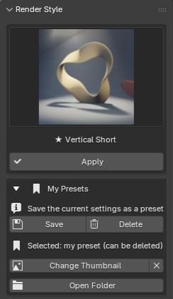
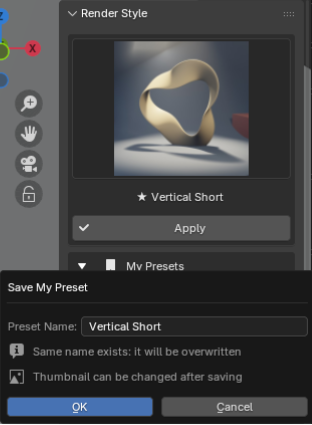
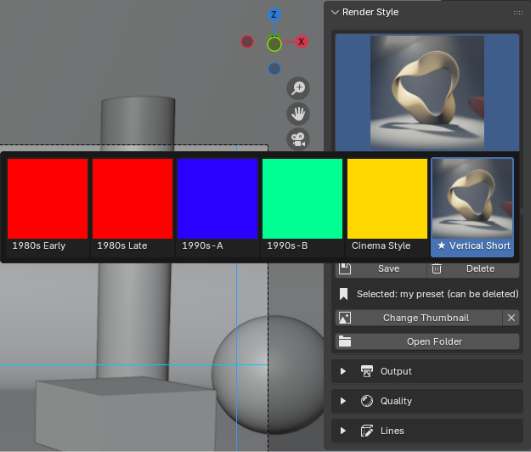
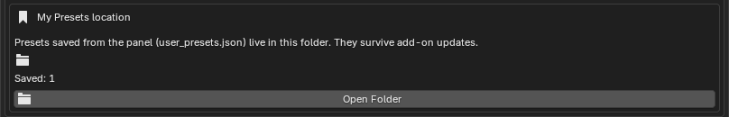

# My Presets

After applying a built-in preset (1980s to Cinema) and tweaking the resolution, fps and so on, you can **save that state under a name**. Saved presets appear in the same thumbnail grid as the built-in ones, marked with **★**, and are applied with the usual **Apply** button. No JSON editing is needed.

{ .ui }

## Saving

1. Set the Render Style items (Output, Quality, Lines) and the camera safe area the way you want. The easiest way is to **Apply** a built-in preset and change only a few values.
2. Open **My Presets** in the **Render Style** panel and press **Save**.
3. Type a name and press **OK**.

{ .ui }

A new ★ thumbnail is added to the grid and selected. It starts with the shared bookmark icon; see "Setting a thumbnail" below to use your own image.

!!! tip "Overwriting"
    Saving with a name that already exists overwrites that preset with the current settings. The dialog shows "Same name exists" so you can check.

## Setting a thumbnail

You can give a saved preset any image as its thumbnail. A render made with that preset works well, because the grid then shows what the look is.

1. Select the ★ preset in the grid.
2. Press **Change Thumbnail** under **My Presets**.
3. Pick an image (PNG / JPG / WebP …) in the file browser and press **Open**.

The image is cropped to a square at the centre, resized to 256 px and copied next to the preset file, so moving or deleting the original later has no effect. The **×** next to the button restores the shared bookmark icon.

{ .ui }

## Loading (applying)

Select a ★ thumbnail in the grid and press **Apply** — exactly the same as a built-in preset. The items applied are the ones listed below; camera position and objects are not touched.

## Deleting

1. Select the ★ preset to delete in the grid.
2. Press **Delete** under **My Presets** and confirm.

**Delete** is only enabled while one of your own presets is selected. Built-in presets can never be deleted or overwritten.

## What is saved

| Group | Items |
|---|---|
| Output | Resolution X / Y, resolution %, frame rate (FPS / base), color management (view transform, look) |
| Quality | Render engine, samples (render / viewport), filter size, soft shadows, lighting (bounces, caustics, shadow rays / steps / resolution), volumetrics (tile size, samples, distribution, shadows, step rate, max steps, bounces) |
| Lines | FreeStyle on / off |
| Camera | Safe-area margin (px), perspective / orthographic, clip start / end, depth of field on / off |

## Where presets are stored

Presets are saved as `user_presets.json` in Blender's user configuration folder, with thumbnails in `icons/` next to it, so **they survive add-on updates** (reinstalling the ZIP). Press **Open Folder** in the panel, or **Open Folder** under **My Presets location** in the add-on preferences (Edit > Preferences > Add-ons > RenderFlow Studios), to open that location; copy `user_presets.json` and `icons/` to back them up or move them to another PC.

{ .ui }

The preferences also show the path and how many presets are saved. This works even before activation or when the license has lapsed, so you can always retrieve your backups.

```
(Windows example)
C:\Users\<name>\AppData\Roaming\Blender Foundation\Blender\4.5\config\RenderFlow_Studios\user_presets.json
```

!!! note "When upgrading Blender"
    The folder is per Blender version, so presets are not carried over automatically. Copy the file to the same location under the new version.
