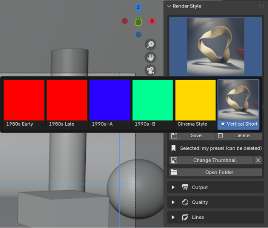
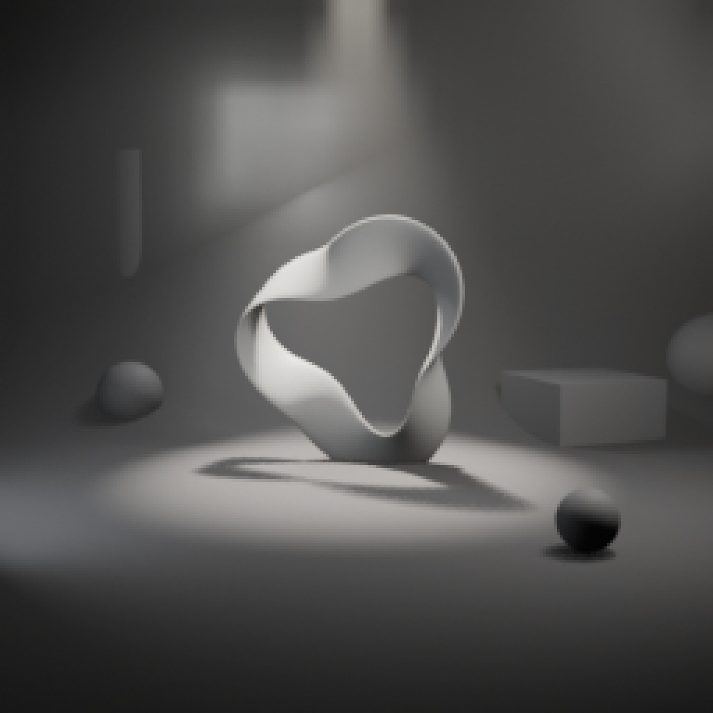
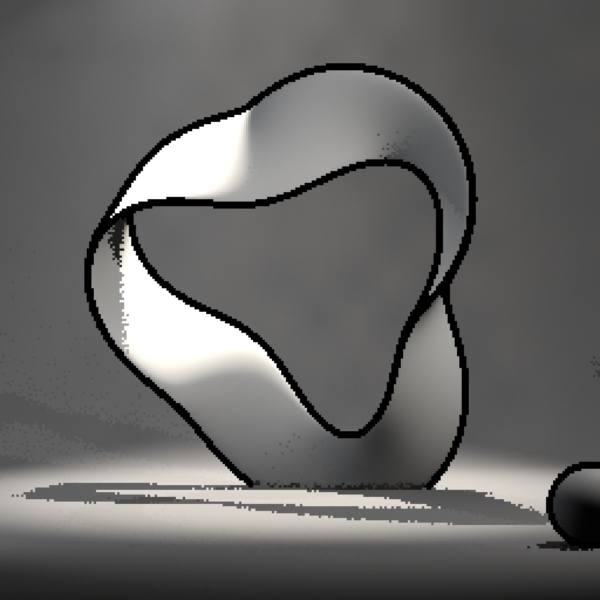
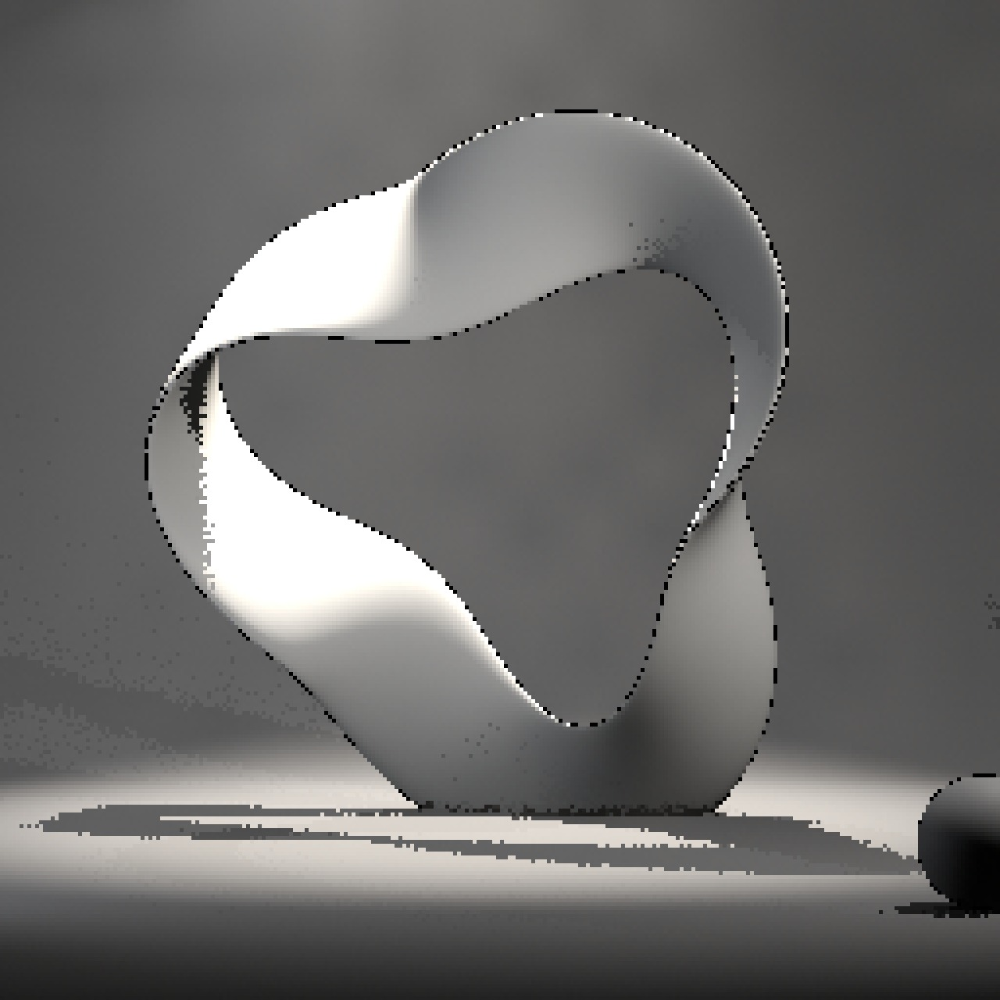
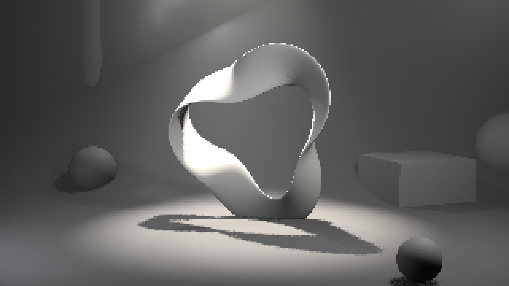
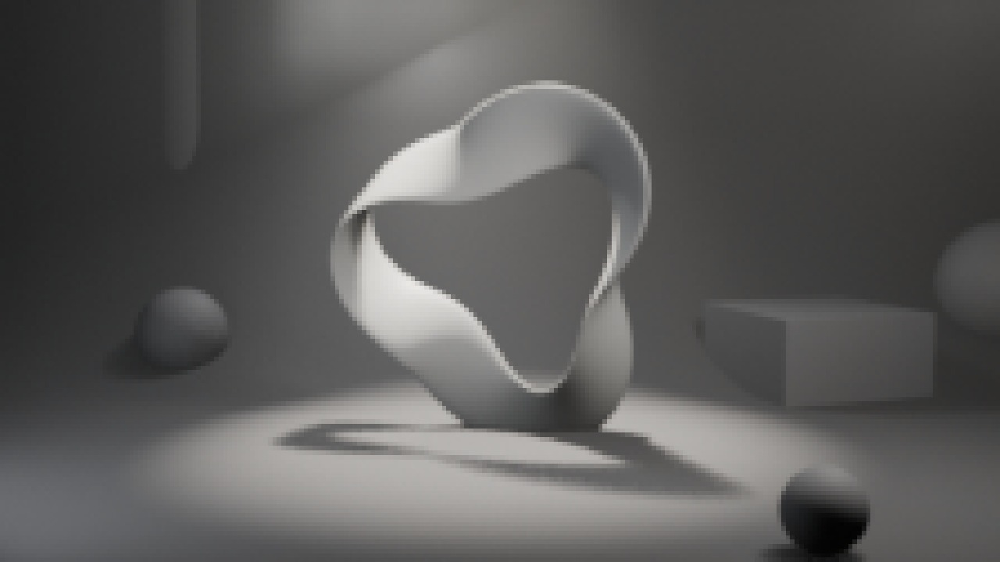
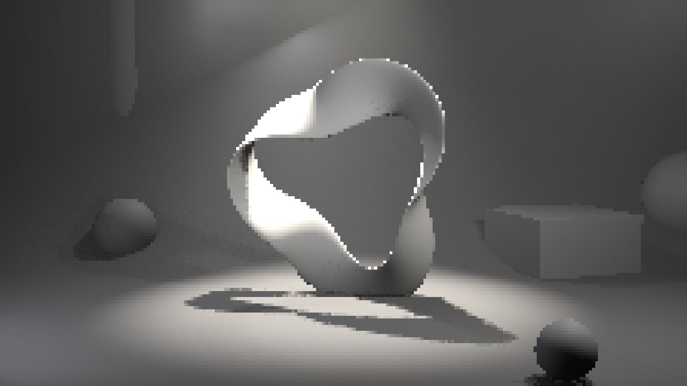
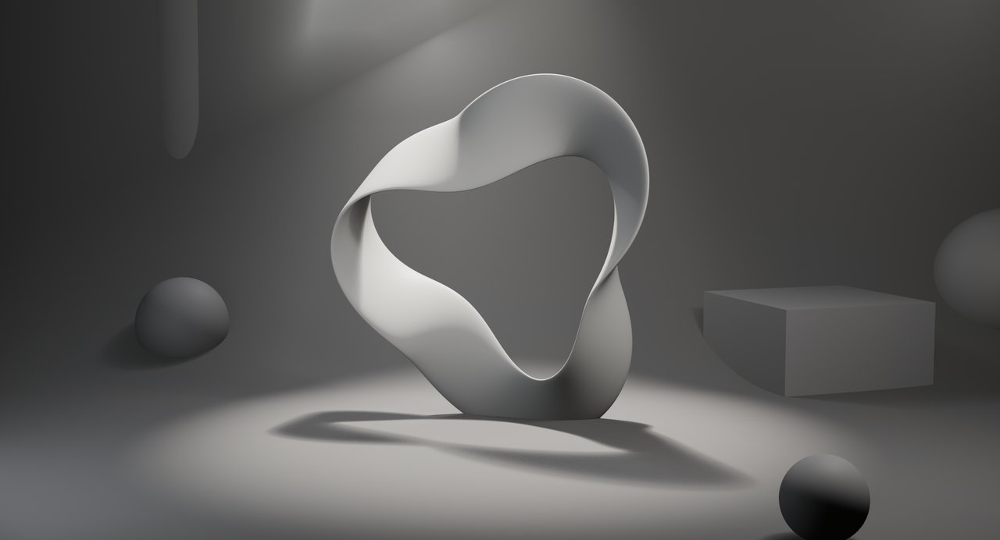
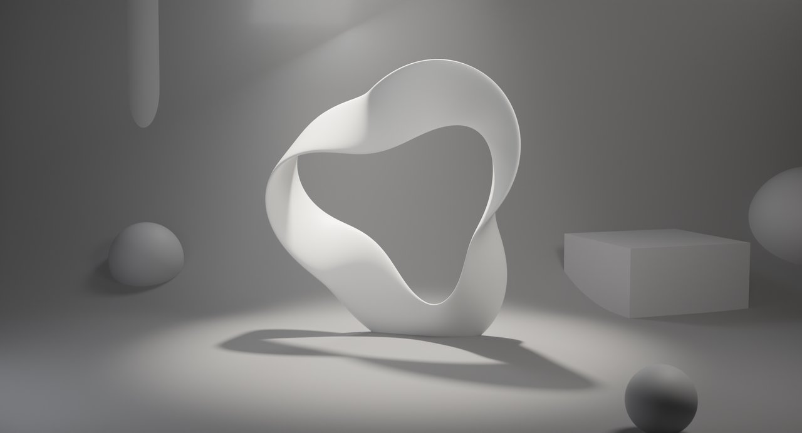

# Render Style

3D Viewport sidebar → **RenderFlow Studios** tab → **Render Style** panel.

{ .ui }

## Selecting and applying a preset

Clicking the thumbnail lists the built-in presets together with your own ★ [My Presets](my_presets.md).

1. Click a style in the icon grid (the selected name appears under the grid).
2. Press **✓ Apply**. The items in the table below are written to the scene and the active camera.

Previous settings are not kept, so save your `.blend` first if needed.

!!! tip "Saving your own settings"
    Settings you change after applying can be saved under a name in [My Presets](my_presets.md) and recalled from the same grid.

## Built-in presets

Each preset shown **before** (Blender defaults: EEVEE, AgX, 64 samples, only the resolution matched to the preset) and **after** applying it. The sample scene contains a fog volume crossed by a spotlight beam, so differences in volumetric and shadow quality show up in the light shaft and shadow edges. Low-resolution presets are shown enlarged, so the pixels are visible as-is.

<b>1980s Early</b> — EEVEE / 256×256 / 15fps

<figure markdown="span">

<figcaption>Before (Blender default)</figcaption>
</figure>
<figure markdown="span">

<figcaption>After</figcaption>
</figure>

Orthographic, 1 sample, FreeStyle outlines, Standard. Pixel-art feel

<b>1980s Late</b> — EEVEE / 2560×2560 (10%) / 15fps

<figure markdown="span">

<figcaption>Before (Blender default)</figcaption>
</figure>
<figure markdown="span">

<figcaption>After</figcaption>
</figure>

Same look kept at high resolution, pixelated by 10% scaling

<b>1990s-A</b> — EEVEE / 320×180 / 30fps

<figure markdown="span">

<figcaption>Before (Blender default)</figcaption>
</figure>
<figure markdown="span">

<figcaption>After</figcaption>
</figure>

Perspective, 8 samples. Low-poly console look

<b>1990s-B</b> — EEVEE / 224×126 / 30fps

<figure markdown="span">

<figcaption>Before (Blender default)</figcaption>
</figure>
<figure markdown="span">

<figcaption>After</figcaption>
</figure>

Filter size 0.01 for hard edges, handheld look

<b>Cinema style</b> — Cycles / 2880×1557 / 24fps

<figure markdown="span">

<figcaption>Before (Blender default)</figcaption>
</figure>
<figure markdown="span">

<figcaption>After</figcaption>
</figure>

512 samples, Filmic (Medium High Contrast), depth of field, high-quality volumetrics

## What gets written

| Group | Items |
|---|---|
| Output | Resolution X / Y / %, frame rate, view transform (Standard / Filmic / AgX) and look (contrast) |
| Quality | Render engine, render / viewport samples, filter size, soft shadows (EEVEE), lighting (EEVEE shadow rays / steps / resolution, Cycles bounces and caustics), volumetrics |
| Lines | FreeStyle on / off |
| Camera | Projection (perspective / orthographic), clip start / end, depth of field on / off, **safe-area margin** |

!!! note "Camera items"
    Camera items are written to the scene's active camera (`Scene > Camera`). If the scene has no camera, they are skipped.

## Output / Quality / Lines sections

The three collapsible sections below the Apply button let you check and fine-tune values after applying. They edit Blender's standard properties directly, so changes are reflected in the Render properties too.

### Output
- **Resolution X / Y / %**
- **Frame Rate**: FPS and base
- **View transform**: color management view transform

### Quality
- **Render engine**
- **Samples**: Render / Viewport (Cycles `samples` / `preview_samples`, EEVEE TAA samples)
- **Filter size (px)**: smaller is sharper. Retro presets use 0.01–0.2, Cinema uses 1.5
- **Soft Shadows**: EEVEE only
- **Lighting** (collapsible): EEVEE shadow rays / steps / resolution; Cycles max / diffuse / glossy bounces and caustics
- **Volumetrics** (collapsible): EEVEE tile size / samples / shadows, or Cycles step rate / max steps / bounces depending on the engine

### Lines
- **FreeStyle**: when on, line thickness mode (absolute / relative) and thickness appear
