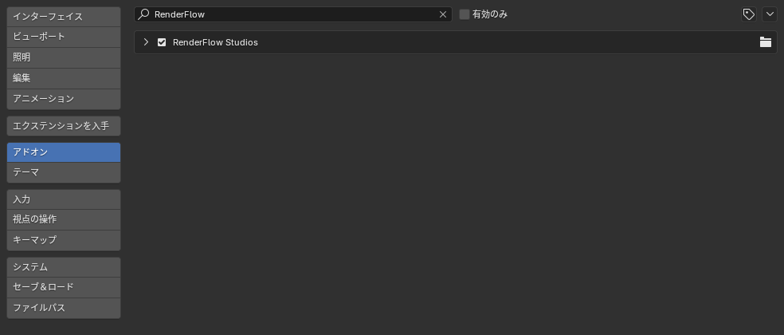
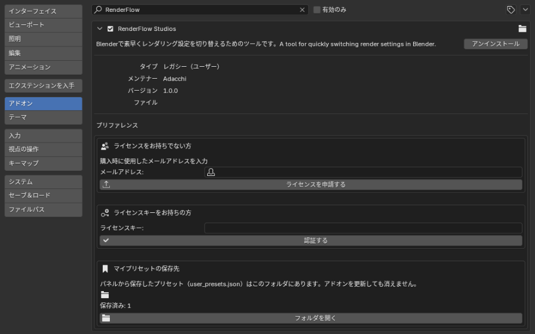
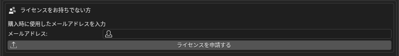
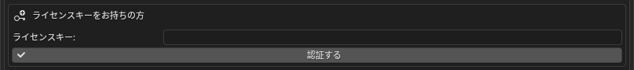
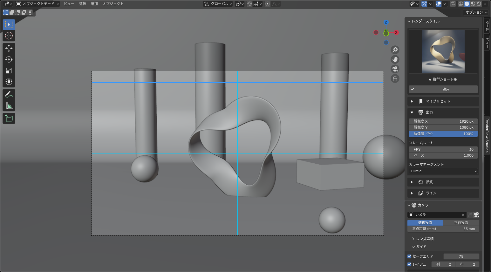

# ライセンス認証

RenderFlow Studios は、購入者ごとに発行される **ライセンスキー** で機能を有効化します。
認証は Preferences > Add-ons > RenderFlow Studios の設定欄で行います。

## 設定欄を開く

1. **編集 > プリファレンス**（Edit > Preferences）を開き、左のメニューから **アドオン** を選びます。
2. 検索欄に `RenderFlow` と入力し、**RenderFlow Studios** の左にある **▸** をクリックして展開します。

{ .ui }

展開すると、次のようなライセンス設定欄が表示されます。

{ .ui }

上段が **ライセンスをお持ちでない方（申請）**、中段が **ライセンスキーをお持ちの方（認証）** です。初めての方は上段 → 中段の順に進みます。いちばん下の **マイプリセットの保存先** は認証とは無関係で、[マイプリセット](my_presets.md) のバックアップ用です。

## ライセンスキーをお持ちでない方（申請）

{ .ui }

1. **メールアドレス** に、購入時に使用したメールアドレスを入力します。
2. **ライセンスを申請する** をクリックします。確認ダイアログでアドレスを確認し、OK を押します。
3. 「申請完了！確認メールをお送りしました。」と表示されれば申請は完了です。
4. 承認後、入力したアドレス宛にライセンスキーがメールで届きます。

!!! warning "申請できない場合"
    「アドオンのキーが更新されたため、新しいアドオンをダウンロードしてインストールしてください」と表示された場合は、古いバージョンの ZIP を使用しています。最新版を入れ直してから申請してください。

## ライセンスキーをお持ちの方（認証）

{ .ui }

1. **ライセンスキー** 欄にメールで受け取ったキーを貼り付けます。
2. **認証する** をクリックします。
3. 「認証成功！パネルが有効になりました」と表示され、3D ビューのサイドバーに **RenderFlow Studios** タブが追加されます。

{ .ui }

## 認証後の動作

- 認証結果は端末ごとにキャッシュされ、Blender を再起動しても認証状態が保持されます。
- 起動時に自動でキャッシュを確認するため、**オフラインでも利用できます**。
- 一定期間ごとにバックグラウンドでサーバーと照合します。このとき通信できなくても、直ちに機能が停止することはありません。

## エラーメッセージと対処

| 表示 | 原因 | 対処 |
|---|---|---|
| ライセンスキーが無効です | キーの入力ミス、または別製品のキー | メール本文からコピーし直してください |
| ライセンスの有効期限が切れています | 期限付きライセンスの期限切れ | 更新手続きを行ってください |
| ライセンスが失効しています | 返金・規約違反などによる無効化 | サポートまでお問い合わせください |
| アクティベーション上限に達しています | 登録できる端末数を超えています | 使用しなくなった端末の解除を依頼してください |
| 認証サーバーに接続できません | ネットワーク不通、プロキシ、ファイアウォール | 接続を確認して再試行してください。既に認証済みの端末ならキャッシュで動作します |

!!! note "1 ライセンスで使える端末数"
    通常は同一ユーザーの複数端末（例：デスクトップとノート）で使用できます。上限に達した場合は、[ヘルプ](help.md) の連絡先までご相談ください。
