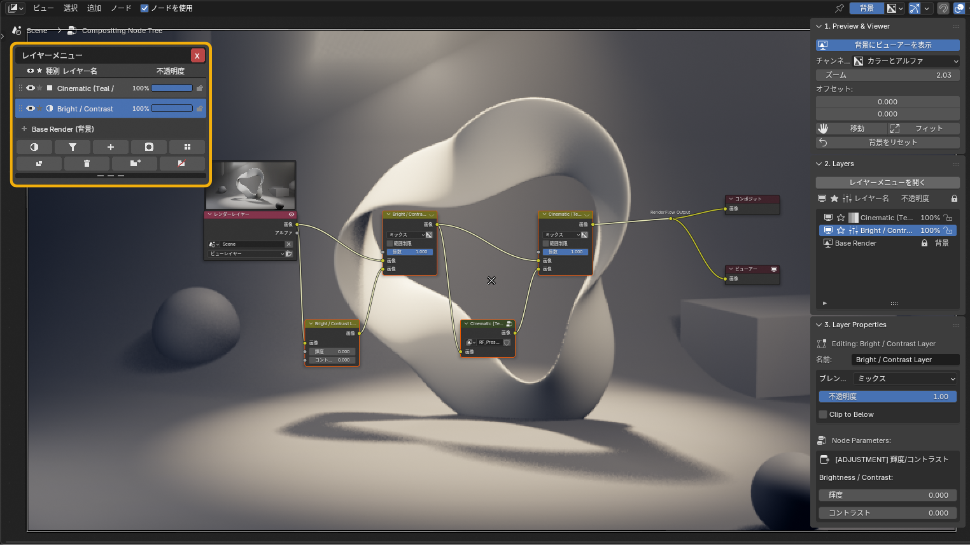
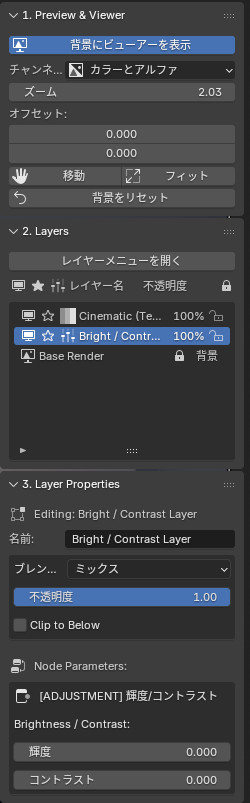
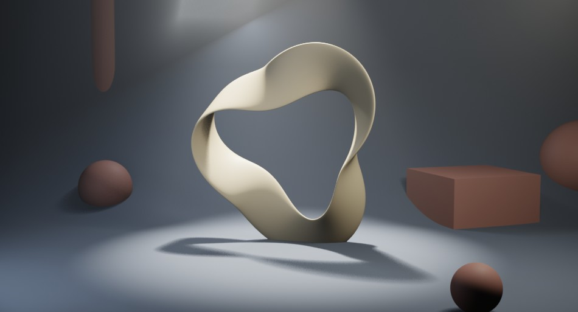
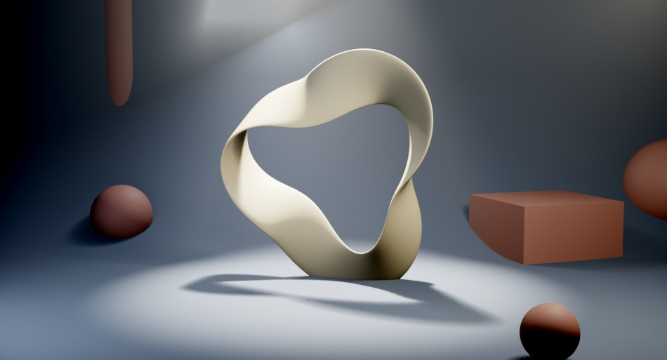
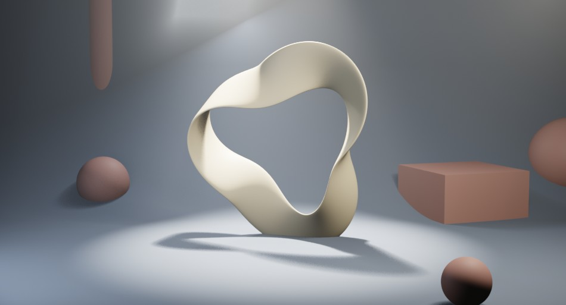
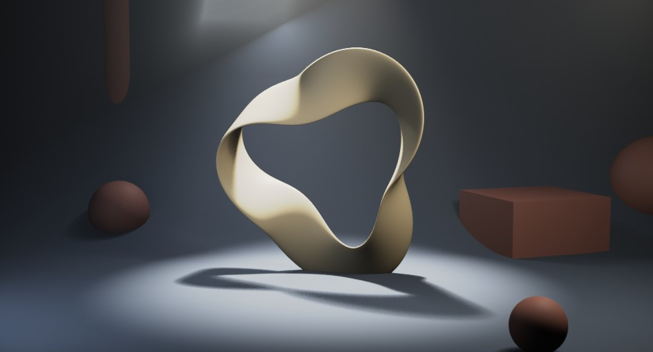
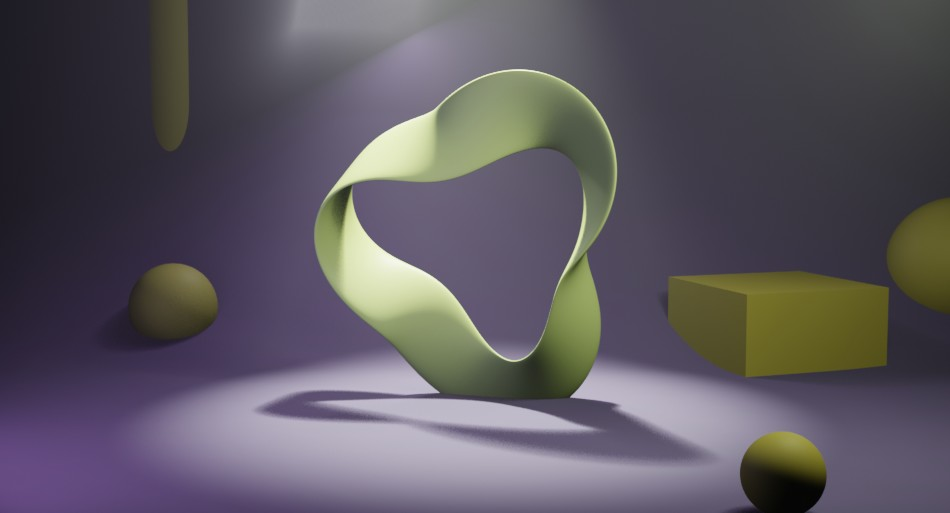
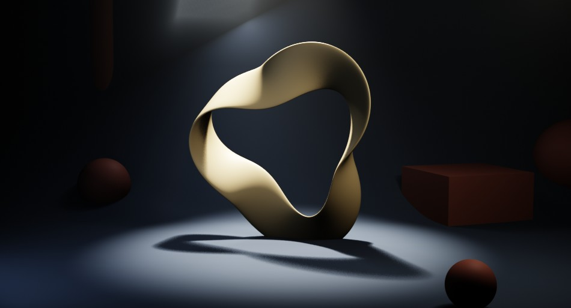

# 調整レイヤー

**レイヤーを追加 → 調整レイヤーを追加** で追加します。色や明るさを整えるレイヤーで、追加後に Layer Properties で種類を切り替えられます。各カードの左が適用前、右が適用後（サンプルシーンに 1 枚だけ追加してレンダリング）です。

{ .ui }

レイヤーメニュー（HUD）下部のボタン列の左端 **調整レイヤーを追加** から種類を選びます。各ボタンの詳細は [レイヤーメニュー（HUD）の各部](compositor.md#hud) を参照してください。追加したレイヤーのパラメータは Layer Properties の **Node Parameters** に表示されます。

{ .ui }

## 調整レイヤーの種類

<b>明るさ / コントラスト</b> — 全体の明るさと明暗差を調整

<figure markdown="span">

<figcaption>適用前</figcaption>
</figure>
<figure markdown="span">

<figcaption>適用後</figcaption>
</figure>

Blender ノード: Bright/Contrast

パラメータ: Bright（明るさ）、Contrast（コントラスト）

比較の設定: Bright 20 / Contrast 45

<b>露出</b> — カメラの露出のように EV 単位で全体を明るく／暗く

<figure markdown="span">

<figcaption>適用前</figcaption>
</figure>
<figure markdown="span">

<figcaption>適用後</figcaption>
</figure>

Blender ノード: Exposure

パラメータ: Exposure（EV。+1 で 2 倍の明るさ）

比較の設定: Exposure +1.0

<b>カラーバランス</b> — シャドウ / 中間調 / ハイライトを別々の色に振る

<figure markdown="span">

<figcaption>適用前</figcaption>
</figure>
<figure markdown="span">

<figcaption>適用後</figcaption>
</figure>

Blender ノード: Color Balance（Lift / Gamma / Gain）

パラメータ: Lift（シャドウの色）、Gamma（中間調の色）、Gain（ハイライトの色）

比較の設定: Lift (0.95, 0.97, 1.08) で影を青く / Gain (1.15, 1.02, 0.85) で明部を橙に

<b>RGB カーブ</b> — カーブで階調を自由に整える。S 字にするとコントラストが付く

<figure markdown="span">

<figcaption>適用前</figcaption>
</figure>
<figure markdown="span">

<figcaption>適用後</figcaption>
</figure>

Blender ノード: RGB Curves

パラメータ: カーブエディタ（C = 全体、R / G / B = 各チャンネル）

比較の設定: C カーブに (0.25, 0.18) と (0.75, 0.85) の点を追加した S 字

<b>色相 / 彩度</b> — 色相を回し、彩度と明度を調整

<figure markdown="span">

<figcaption>適用前</figcaption>
</figure>
<figure markdown="span">

<figcaption>適用後</figcaption>
</figure>

Blender ノード: Hue/Saturation/Value

パラメータ: Hue（0.5 が変化なし）、Saturation（0 でモノクロ）、Value

比較の設定: Hue 0.62 / Saturation 1.4

<b>ガンマ</b> — 中間調の明るさだけを持ち上げる／沈める

<figure markdown="span">

<figcaption>適用前</figcaption>
</figure>
<figure markdown="span">

<figcaption>適用後</figcaption>
</figure>

Blender ノード: Gamma

パラメータ: Gamma（1 より小さいと明るく、大きいと暗く）

比較の設定: Gamma 1.8

## 使い方のコツ

- 調整レイヤーは**下にあるすべてのレイヤー**に効きます。特定の範囲だけに効かせたい場合は [マスクとクリッピング](masks.md) を参照してください。
- 露出とカラーバランスで大きく整えてから、RGB カーブで詰めるのが定石です。
- 不透明度を下げると効果を弱められるので、パラメータを戻すより素早く調整できます。
