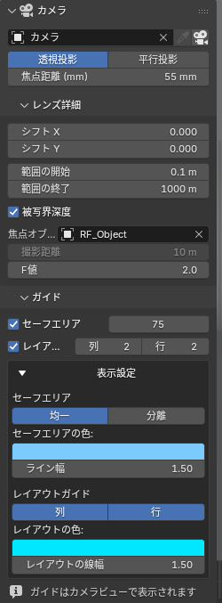

# カメラ

3D ビューポートのサイドバー → **RenderFlow Studios** タブ → **カメラ** パネル。
カメラの選択からレンズ設定までをひとつの場所にまとめています。

{ .ui }

!!! tip "先にレンダースタイルを適用してください"
    想定している流れは **レンダースタイルを適用 → カメラを調整** です。プリセットの適用は投影方式（透視 / 平行）、クリップ距離、被写界深度の ON / OFF、セーフエリア余白をカメラに書き込むため、先にカメラを詰めてから適用すると上書きされます。スタイルで大枠を決めたあと、このパネルで焦点距離や F 値を追い込んでください。

## カメラの選択

| UI | 動作 |
|---|---|
| カメラ選択（ドロップダウン） | シーンカメラ（`Scene > Camera`）を切り替えます |
| :material-eyedropper: スポイト | 3D ビューで選択中のカメラオブジェクトをシーンカメラに設定します |
| :material-camera: カメラビュー | 3D ビューのカメラビュー（++numpad0++）を切り替えます |

!!! note "操作対象のカメラ"
    パネルは「3D ビューに表示中のカメラ → シーンカメラ → 選択中のカメラ → シーン内の最初のカメラ」の優先順で対象を決めます。通常はシーンカメラが対象になります。

## 投影方式とレンズ

| 項目 | 説明 |
|---|---|
| 透視投影 / 平行投影 | 投影方式の切り替え。80年代プリセットは平行投影を使います |
| 焦点距離 (mm) | 透視投影のときに表示。カメラのレンズ単位が「視野角」の場合は視野角が表示されます |
| 平行投影スケール | 平行投影のときに表示 |

## レンズ詳細（サブパネル）

初期状態では閉じています。クリックで展開します。

| 項目 | 説明 |
|---|---|
| シフト X / Y | レンズシフト。あおり補正や構図の微調整に |
| クリップ 開始 / 終了 | 描画される距離の範囲。レンダースタイル適用時に書き換わります |
| 被写界深度 | ON にするとフォーカス対象、フォーカス距離、F 値が表示されます。フォーカス対象を指定するとフォーカス距離は無効になります |

## ガイド（サブパネル）

セーフエリアとレイアウトガイドの設定です。カメラごとに独立して保持されます。
→ [ガイド（セーフエリア）](camera_guides.md)
