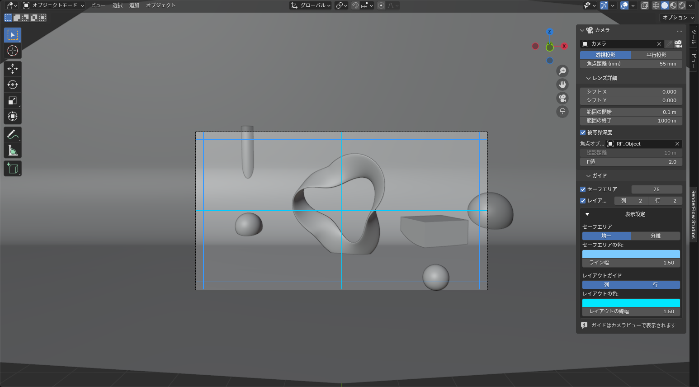

# ガイド（セーフエリア）

**カメラ** パネル内の **ガイド** サブパネル。カメラビューにセーフエリアとレイアウトガイドを重ねて表示します。

{ .ui }

!!! info "カメラごとに保存されます"
    ガイドの設定はカメラデータ（`bpy.types.Camera`）に保存されます。シネスコ用のカメラ A と縦型ショート用のカメラ B で別々のセーフエリアを持てます。カメラをリンク複製した場合は設定も共有されます。

## セーフエリア

| 項目 | 説明 |
|---|---|
| ☐ セーフエリア | ガイド表示の ON / OFF |
| 余白 (px) | **レンダー解像度基準**のピクセル値。フルHD で 50px なら画面幅の約 2.6% |

レンダースタイルを適用すると、余白はプリセットの `safe area px` で上書きされます。字幕用に広げるなどの微調整は、スタイル適用後にここで行ってください（例：映画風 = 75px、1980年代前半 = 8px）。

## レイアウトガイド

| 項目 | 説明 |
|---|---|
| ☐ レイアウトガイド | 分割線の表示 ON / OFF |
| 列 / 行 | 分割数（2〜100）。3×3 で三分割構図 |

## 表示設定（折りたたみ）

| 項目 | 説明 |
|---|---|
| セーフエリア：均一 / 分離 | 分離にすると左右と上下で別の余白を指定できます（例：下部だけ字幕用に広く） |
| セーフエリアの色 / 線幅 | |
| レイアウト：列 / 行 の有効化 | 列だけ、行だけの表示 |
| レイアウトの色 / 線幅 | |

!!! tip "ガイドはカメラビューでのみ表示されます"
    通常のビューでは何も描画されません。パネル下部に「ガイドはカメラビューで表示されます」と出ている場合は、++numpad0++ でカメラビューに切り替えてください。ガイドはビューポート表示のみで、レンダリング結果には含まれません。
