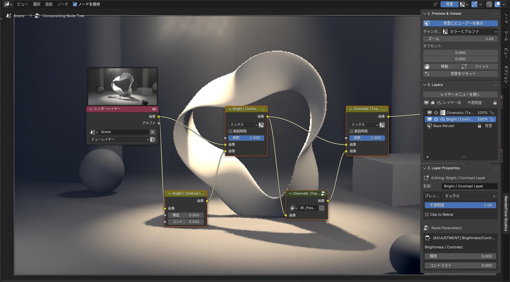
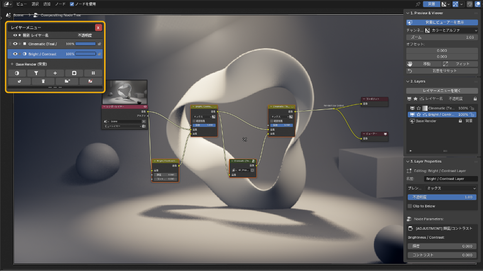
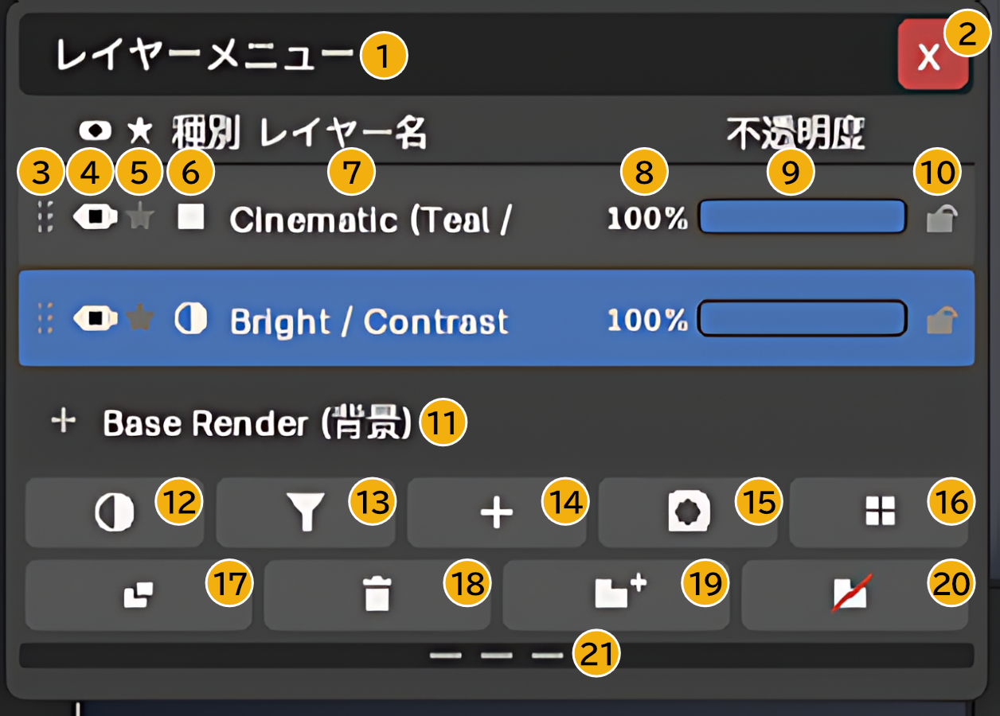

# コンポジットレイヤー

コンポジター（ノードエディタ）のサイドバー → **RenderFlow Studios** タブ。
Blender のノードベースのコンポジターを、Photoshop / After Effects のような**レイヤー**として操作します。

{ .ui }

!!! abstract "しくみ"
    ノードが実体、レイヤーは操作インターフェースです。レイヤーを 1 枚追加すると、内部では `MixRGB` ノードが 1 つ生成され、レンダーレイヤー → Mix → Mix → … → Composite と直列に接続されます。ノードエディタで直接編集しても構いませんが、レイヤー UI との整合が崩れた場合は **Sync UI to Nodes** で同期し直せます。

## 3 つのパネル

### 1. Preview & Viewer
- コンポジット結果をビューアーノードに接続し、背景（バックドロップ）に表示します。
- **背景を移動 / フィット / リセット**：バックドロップのズームとオフセット
- **Before / After**：レイヤー適用前後の比較表示

### 2. Layers
- レイヤー一覧。上が前面です。
- **レイヤーを追加** メニュー：入力 / 調整レイヤー / フィルター / プリセット / マスク
- 行のドラッグで並べ替え（レイヤー HUD）、**複製**、**削除**、**ソロ**（そのレイヤーだけ表示）
- **新規グループ / グループ解除**、**レイヤー名を変更**

{ .ui }

**レイヤーメニューを開く** を押すと、エディタ上にレイヤーメニュー（HUD）が重なって表示されます。追加・複製・削除・グループ化などの操作はここに集約されています。詳しくは下の [レイヤーメニュー（HUD）の各部](#hud) を参照してください。

### 3. Layer Properties
選択中のレイヤーの設定です。

| 項目 | 説明 |
|---|---|
| 不透明度 | 0〜1 |
| ブレンドモード | ミックス / 暗い方 / 乗算 / 焼き込み / 明るい方 / スクリーン / 覆い焼き / 加算 / オーバーレイ / ソフトライト / リニアライト / 差分 / 除外 / 減算 / 除算 / 色相 / 彩度 / カラー / 値 |
| 種別ごとの設定 | 調整の種類、FX のパラメータ、入力ソース、マスクの形状など |
| クリッピング | 直下のレイヤーの範囲にだけ効果を適用 |

## レイヤーメニュー（HUD）の各部 { #hud }

{ .ui }

| 番号 | 項目 | 説明 |
|---|---|---|
| ① | タイトルバー | ドラッグすると HUD を好きな位置へ移動できます。 |
| ② | 閉じる（×） | HUD を閉じます。**Esc** キーでも閉じられます。 |
| ③ | ドラッグハンドル | ここ（または行の空いている部分）を上下にドラッグすると、レイヤーの順番を入れ替えられます。グループの中へ／外へも移動できます。 |
| ④ | 表示（目） | レイヤーの表示 / 非表示を切り替えます。非表示のレイヤーは結果に影響しません。 |
| ⑤ | ソロ（★） | このレイヤー**だけ**を表示し、ほかを一時的に無効にします。もう一度押すと解除されます。 |
| ⑥ | 種別アイコン | レイヤーの種類（調整 / フィルター / 入力 / マスク / プリセット / グループ）を表します。 |
| ⑦ | レイヤー名 | クリックで選択、**ダブルクリック**で名前の変更ダイアログが開きます（日本語入力可）。 |
| ⑧ | 不透明度（数値） | クリックすると数値を直接入力できます（0〜100）。 |
| ⑨ | 不透明度スライダー | ドラッグで不透明度を変更します。複数のレイヤーを選択していれば、まとめて変更されます。 |
| ⑩ | ロック（鍵） | ON にすると不透明度の変更やドラッグ移動ができなくなります。誤操作の防止に。 |
| ⑪ | Base Render（背景） | いちばん下のベース（レンダーレイヤー）。移動・削除はできません。 |
| ⑫ | 調整レイヤーを追加 | 明るさ / 露出 / カラーバランス / RGB カーブ / 色相・彩度 / ガンマ から選んで追加します。→ [調整レイヤー](adjustment.md) |
| ⑬ | フィルターを追加 | アセットライブラリの FX フィルターを追加します。→ [FX フィルター一覧](fx_filters.md) |
| ⑭ | 入力を追加 | シーン（レンダーレイヤー）/ 画像 / 連番画像 / 動画クリップ を追加します。 |
| ⑮ | マスクを追加 | 楕円 / ボックス / ダブルエッジ / ペイントマスク を追加します。→ [マスクとクリッピング](masks.md) |
| ⑯ | プリセットを追加 | Cinematic など 9 種の Look プリセットを追加します。→ [Look プリセット一覧](look_presets.md) |
| ⑰ | 複製 | 選択中のレイヤーを複製します。 |
| ⑱ | 削除 | 選択中のレイヤーを削除します。 |
| ⑲ | 新規グループ | 選択中のレイヤーをまとめてグループにします。グループ行の ▸ で折りたたみ、目で一括表示切替ができます。 |
| ⑳ | グループ解除 | 選択中のグループを解除し、中のレイヤーを元に戻します。 |
| ㉑ | サイズ変更ハンドル | 上下にドラッグすると、レイヤー一覧の表示行数を変えられます。行数を超えた分はホイールでスクロールします。 |

!!! tip "並べ替えのコツ"
    上にあるレイヤーほど**前面**（後から適用）です。調整レイヤーは自分より下のレイヤーすべてに効くので、全体を整える調整はいちばん上に、特定のレイヤーだけに効かせたいものはそのレイヤーの直上に置き、クリッピングを ON にします。

## 基本操作の流れ

1. **レイヤーを追加 → 入力 → シーン（レンダーレイヤー）** でベースを置きます（初回は自動で追加されます）。
2. **調整レイヤーを追加** で色や露出を整えます。→ [調整レイヤー](adjustment.md)
3. **フィルターを追加** または **プリセットを追加** で質感を加えます。→ [FX フィルター一覧](fx_filters.md) / [Look プリセット一覧](look_presets.md)
4. 効果を一部にだけかけたいときは **マスクを追加** し、クリッピングを有効にします。→ [マスクとクリッピング](masks.md)
5. 不透明度で効きを調整し、Before / After で確認します。

!!! warning "フィルム透過が OFF のときのフィルター"
    一部のフィルター（透明部分を使うもの）は、レンダープロパティの **Film > Transparent** が OFF だと機能しません。パネルに警告が出た場合は **フィルム透過を有効化** ボタンで切り替えられます。
