# FX フィルター一覧

**レイヤーを追加 → フィルターを追加** から選びます。各カードの左が適用前、右が適用後です。すべて同じ元画像に、既定のパラメータで適用しています。

!!! info "事前準備"
    Blur 以外のフィルターは同梱の `FX_filters.blend` をアセットライブラリとして登録すると使えるようになります。→ [インストール › 4. FX フィルターのアセットライブラリを登録](install.md#4-fx)
    フィルターは初回使用時に `.blend` へアペンドされ、以降はファイル内のノードグループが使われます。

## FX1 基本

<b>Blur</b> — ガウスぼかし

<figure markdown="span">

<figcaption>適用前</figcaption>
</figure>
<figure markdown="span">
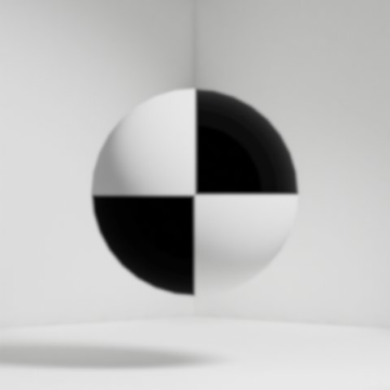
<figcaption>適用後</figcaption>
</figure>

主なパラメータ: サイズ（XY 共通）

<b>Sharpen</b> — 輪郭強調

<figure markdown="span">

<figcaption>適用前</figcaption>
</figure>
<figure markdown="span">
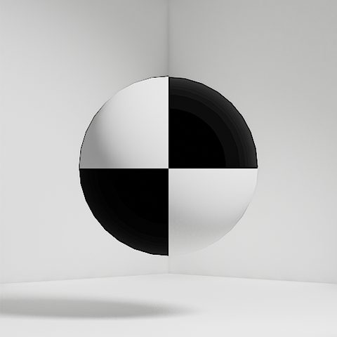
<figcaption>適用後</figcaption>
</figure>

主なパラメータ: 強さ

<b>Glow</b> — 明部のにじみ

<figure markdown="span">

<figcaption>適用前</figcaption>
</figure>
<figure markdown="span">
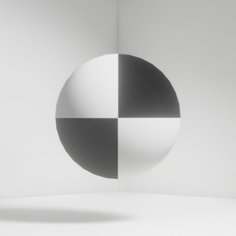
<figcaption>適用後</figcaption>
</figure>

主なパラメータ: しきい値、サイズ、強さ

<b>Edge Detect</b> — エッジ抽出

<figure markdown="span">

<figcaption>適用前</figcaption>
</figure>
<figure markdown="span">
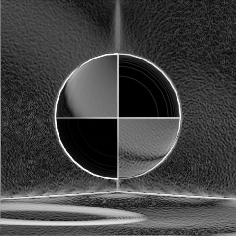
<figcaption>適用後</figcaption>
</figure>

主なパラメータ: 強さ、ミックス

<b>Noise</b> — 粒子ノイズ

<figure markdown="span">

<figcaption>適用前</figcaption>
</figure>
<figure markdown="span">
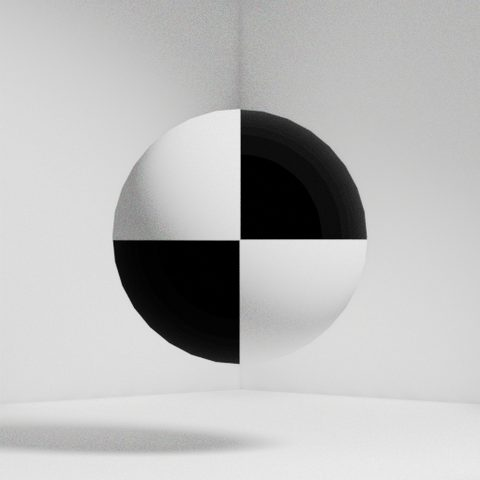
<figcaption>適用後</figcaption>
</figure>

主なパラメータ: テクスチャ種類、ミックス、強さ

## FX2 光学

<b>Chromatic Aberration</b> — 色収差

<figure markdown="span">

<figcaption>適用前</figcaption>
</figure>
<figure markdown="span">
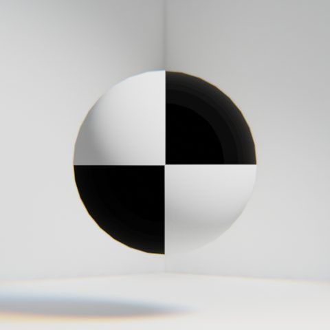
<figcaption>適用後</figcaption>
</figure>

主なパラメータ: ずれ量

<b>Lens Blur Z</b> — Z 深度を使った被写界深度

<figure markdown="span">

<figcaption>適用前</figcaption>
</figure>
<figure markdown="span">
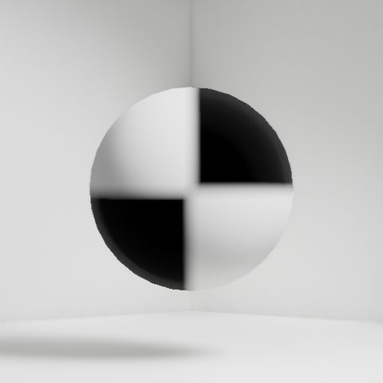
<figcaption>適用後</figcaption>
</figure>

主なパラメータ: F 値、最大ぼかし、Z 正規化

<b>Motion Blur</b> — 方向ぼかし

<figure markdown="span">

<figcaption>適用前</figcaption>
</figure>
<figure markdown="span">
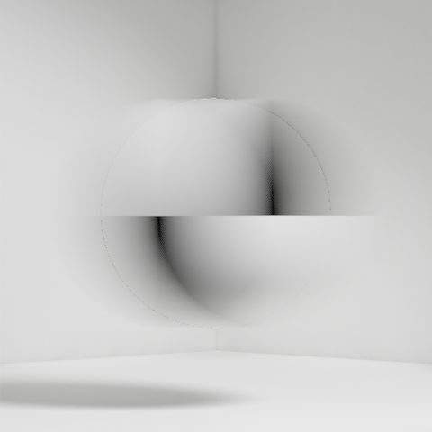
<figcaption>適用後</figcaption>
</figure>

主なパラメータ: 角度、距離

<b>Vignette</b> — 周辺減光

<figure markdown="span">

<figcaption>適用前</figcaption>
</figure>
<figure markdown="span">
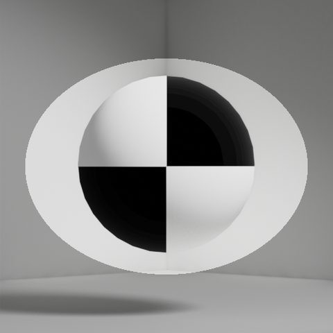
<figcaption>適用後</figcaption>
</figure>

主なパラメータ: 幅、高さ、ぼかし、回転

<b>魚眼</b> — レンズ歪み

<figure markdown="span">

<figcaption>適用前</figcaption>
</figure>
<figure markdown="span">
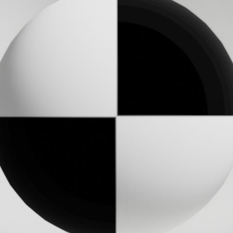
<figcaption>適用後</figcaption>
</figure>

主なパラメータ: 歪み量

## FX3 色

<b>セピア</b> — 褪せた褐色調

<figure markdown="span">

<figcaption>適用前</figcaption>
</figure>
<figure markdown="span">
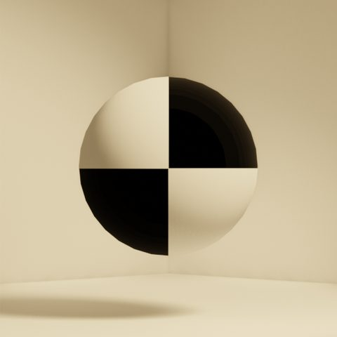
<figcaption>適用後</figcaption>
</figure>

<b>ネオン</b> — 高彩度の発光調

<figure markdown="span">

<figcaption>適用前</figcaption>
</figure>
<figure markdown="span">
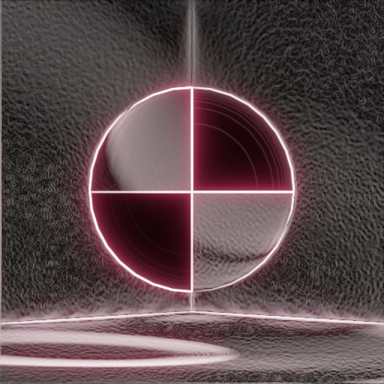
<figcaption>適用後</figcaption>
</figure>

## FX4 NPR（非写実）

<b>コミック</b> — 階調の減色＋輪郭線

<figure markdown="span">

<figcaption>適用前</figcaption>
</figure>
<figure markdown="span">
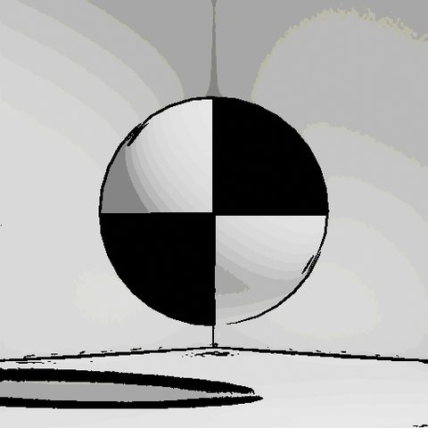
<figcaption>適用後</figcaption>
</figure>

<b>シルエット</b> — 影絵風の単色化

<figure markdown="span">

<figcaption>適用前</figcaption>
</figure>
<figure markdown="span">
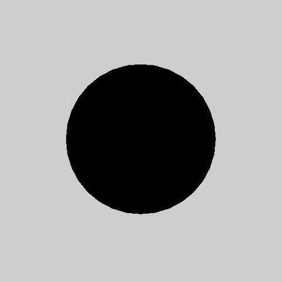
<figcaption>適用後</figcaption>
</figure>

<b>水彩</b> — にじみとテクスチャ

<figure markdown="span">

<figcaption>適用前</figcaption>
</figure>
<figure markdown="span">
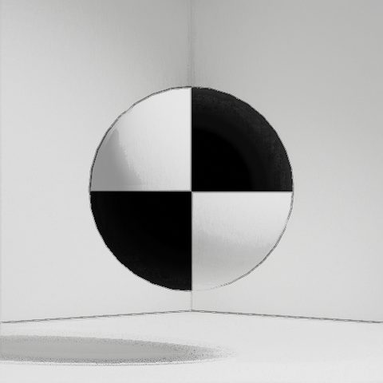
<figcaption>適用後</figcaption>
</figure>

<b>水彩画風 2</b> — より紙質感の強い水彩

<figure markdown="span">

<figcaption>適用前</figcaption>
</figure>
<figure markdown="span">
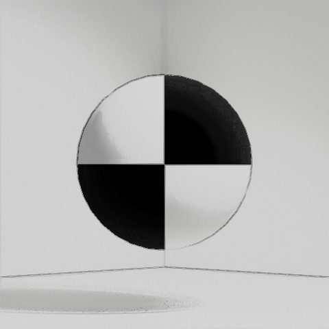
<figcaption>適用後</figcaption>
</figure>

<b>油絵</b> — 筆致のある厚塗り

<figure markdown="span">

<figcaption>適用前</figcaption>
</figure>
<figure markdown="span">
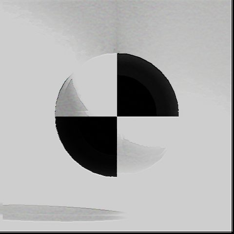
<figcaption>適用後</figcaption>
</figure>

<b>点描</b> — ドットの集合で表現

<figure markdown="span">

<figcaption>適用前</figcaption>
</figure>
<figure markdown="span">
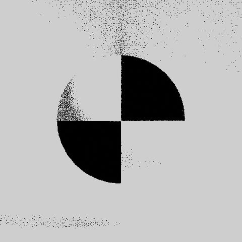
<figcaption>適用後</figcaption>
</figure>

<b>線画</b> — 輪郭のみ

<figure markdown="span">

<figcaption>適用前</figcaption>
</figure>
<figure markdown="span">
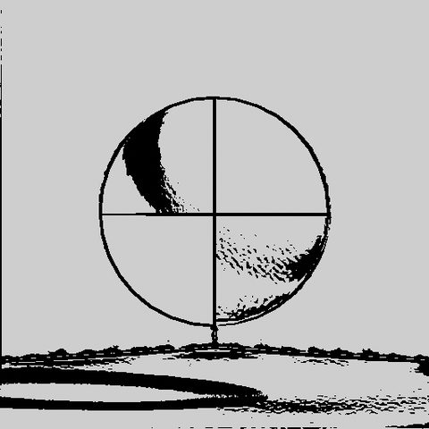
<figcaption>適用後</figcaption>
</figure>

<b>線画 2</b> — 太めの線

<figure markdown="span">

<figcaption>適用前</figcaption>
</figure>
<figure markdown="span">
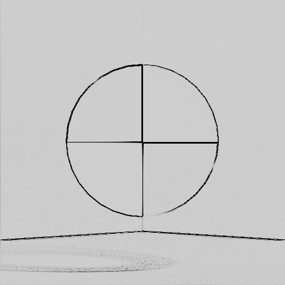
<figcaption>適用後</figcaption>
</figure>

## FX5 レトロ

<b>8bit</b> — 減色＋ドット化

<figure markdown="span">

<figcaption>適用前</figcaption>
</figure>
<figure markdown="span">
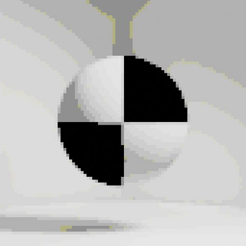
<figcaption>適用後</figcaption>
</figure>

<b>8bit LCD</b> — 携帯機の液晶風（緑系 4 階調）

<figure markdown="span">

<figcaption>適用前</figcaption>
</figure>
<figure markdown="span">

<figcaption>適用後</figcaption>
</figure>

<b>16bit</b> — 16bit 機風の減色

<figure markdown="span">

<figcaption>適用前</figcaption>
</figure>
<figure markdown="span">
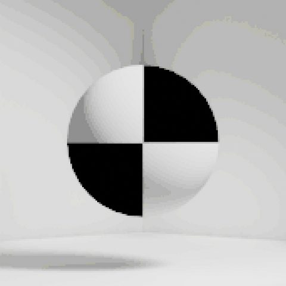
<figcaption>適用後</figcaption>
</figure>

!!! tip "レンダースタイルとの組み合わせ"
    「1990年代-A」でレンダリングし、FX5 の 16bit を重ねると、解像度とパレットの両方でレトロ感が揃います。
