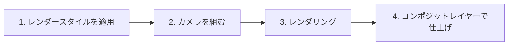
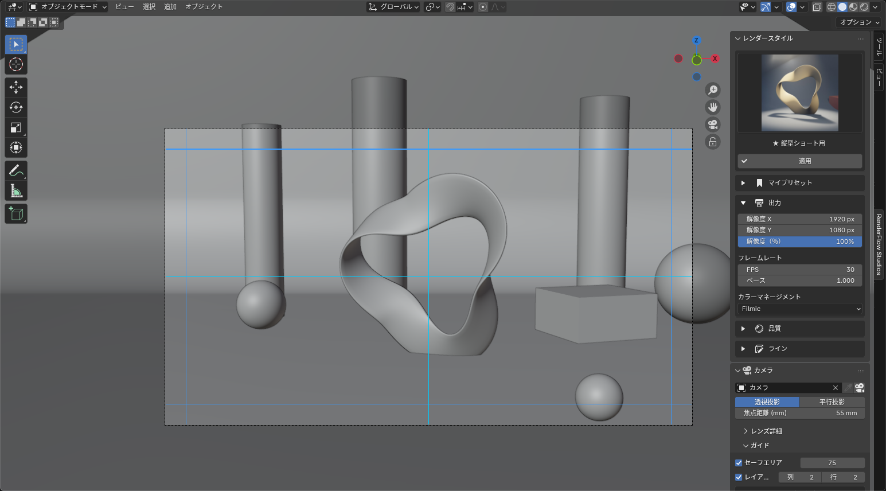

# ガイド

RenderFlow Studio の基本的な流れは次の 4 ステップです。

## パネルの場所

| 機能 | エディタ | 場所 |
|---|---|---|
| レンダースタイル / カメラ | 3D ビューポート | サイドバー（++n++）→ **RenderFlow Studio** タブ |
| コンポジットレイヤー | コンポジター（ノードエディタ） | サイドバー（++n++）→ **RenderFlow Studios** タブ |
| マスクのペイント | 画像エディタ | サイドバー → **RenderFlow Studios** タブ |

{ .ui }

## 1. レンダースタイルを適用する

サイドバーの **レンダースタイル** パネルでアイコンをクリックしてスタイルを選び、**適用** を押します。
エンジン、解像度、サンプル数、fps、カラーマネジメント、カメラの投影方式などがまとめて設定されます。

→ 詳しくは [レンダースタイル](render_style.md)

## 2. カメラを組む

**カメラ** パネルでシーンカメラを選び、焦点距離や被写界深度を調整します。
**ガイド** サブパネルでセーフエリアを表示すると、字幕やテロップの安全領域を確認しながらフレーミングできます。

→ [カメラ](camera.md) / [ガイド（セーフエリア）](camera_guides.md)

## 3. レンダリング

通常どおり ++f12++（静止画）または ++ctrl+f12++（アニメーション）でレンダリングします。
出力形式（PNG / 動画コーデック）は Blender 標準の Output プロパティで設定してください。

## 4. コンポジットレイヤーで仕上げる

コンポジターを開き、サイドバーの **RenderFlow Studios** タブから **レイヤーを追加** します。
調整レイヤーで色を整え、FX フィルターや Look プリセットで質感を加え、マスクで効果範囲を絞ります。

→ [コンポジットレイヤー](compositor.md)

!!! tip "順番のヒント"
    レンダースタイルの適用はカメラの投影方式（透視 / 平行）やクリップ距離、セーフエリア余白も書き換えます。カメラを細かく詰める前にスタイルを決めておくと手戻りが減ります。
