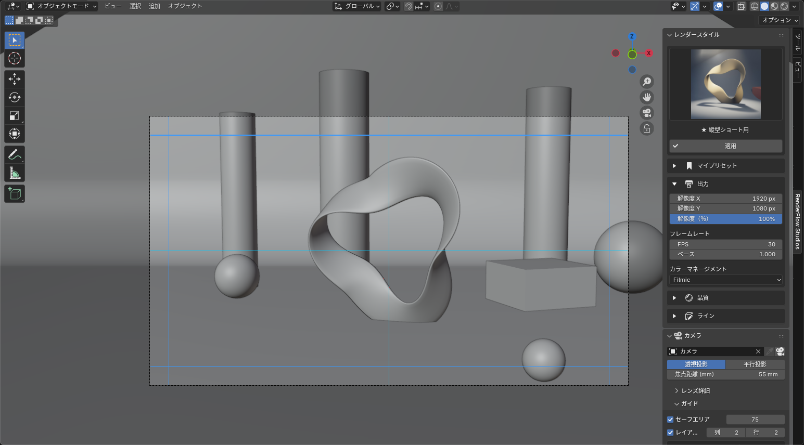

<h1>レンダー設定から <em>仕上げ</em>まで、ひとつのタブで。</h1>

RenderFlow Studios は、映像作品づくりのための Blender アドオンです。「レンダー設定を決める → カメラを組む → レンダリングする → 仕上げる」という流れを、ひとつのサイドバータブとレイヤー式のコンポジターにまとめました。

Blender 4.5 LTS 推奨4.0 以上で動作EEVEE / Cycles日本語 / English UI

[インストール手順](install.md){ .md-button .md-button--primary } [使い方ガイド](guide.md){ .md-button }

<figure markdown style="margin:0">

適用前適用後
<input type="range" min="0" max="100" value="50" aria-label="適用前と適用後を比べるスライダー">

<figcaption>スライダーを左右に動かして比べられます。左はそのままのレンダリング、右はコンポジットレイヤーの Look プリセット「Cinematic (Teal / Orange)」を1枚重ねたものです（サンプルシーン）。</figcaption>
</figure>

<b>5<small>種</small></b>レンダースタイル

<b>22<small>種</small></b>FX フィルター

<b>9<small>種</small></b>Look プリセット

<b>4<small>ステップ</small></b>設定から仕上げまで

## <i class="bi bi-info-circle-fill"></i> 概要 Overview

RenderFlow Studios は、Blender で映像を作るときの「設定 → 撮影 → 仕上げ」を一本の流れにするアドオンです。80〜90年代のレトロ表現から映画風まで、レンダーの設定一式をワンクリックで切り替え、カメラとセーフエリアをサイドバーで整え、レンダリングした絵をレイヤーを重ねる感覚で仕上げられます。ノードを手で組む必要はありません。

## <i class="bi bi-stars"></i> 特徴 Features

<i class="bi bi-film ms-feat-ic" aria-hidden="true"></i><b>レンダースタイル</b>
**設定一式をワンクリックで**

エンジン・解像度・サンプル数・fps・カラーマネジメントを、レトロから映画風までまとめて切り替えます。→ [レンダースタイル](render_style.md)

<i class="bi bi-bookmark-star-fill ms-feat-ic" aria-hidden="true"></i><b>マイプリセット</b>
**自分の設定を残す**

調整した設定を名前を付けて保存し、標準のスタイルと同じ一覧から呼び出せます。→ [マイプリセット](my_presets.md)

<i class="bi bi-camera-reels-fill ms-feat-ic" aria-hidden="true"></i><b>カメラ</b>
**映像向けのカメラ操作**

カメラの選択、レンズ、被写界深度をサイドバーから。投影方式の切り替えもここで行います。→ [カメラ](camera.md)

<i class="bi bi-bounding-box ms-feat-ic" aria-hidden="true"></i><b>ガイド</b>
**カメラごとのセーフエリア**

セーフエリアとレイアウトガイドはカメラごとに保持。シネスコ用と縦型ショート用で別々に持てます。→ [ガイド（セーフエリア）](camera_guides.md)

<i class="bi bi-layers-fill ms-feat-ic" aria-hidden="true"></i><b>コンポジットレイヤー</b>
**レイヤーを重ねて仕上げる**

ドラッグで並べ替え、不透明度、ブレンドモード、グループ化、適用前後の比較。中身は Blender のノードです。→ [コンポジットレイヤー](compositor.md)

<i class="bi bi-magic ms-feat-ic" aria-hidden="true"></i><b>FX・Look</b>
**22 種の FX と 9 種の Look**

ぼかし・グロー・色収差などの光学系、水彩・油彩・線画、8bit / 16bit、映画風の色調。→ [FX フィルター](fx_filters.md) ／ [Look](look_presets.md)

## <i class="bi bi-collection-play-fill"></i> 4ステップで1カット

<figure class="ms-shot" markdown>

<figcaption>3D ビューポートのサイドバー › RenderFlow Studios タブ</figcaption>
</figure>

<a href="render_style.html">1<b>スタイル</b>レンダースタイルを選んで適用。エンジンから色まで一度に決まる。</a>
<a href="camera.html">2<b>カメラ</b>レンズと被写界深度を決め、セーフエリアを見ながら構図を組む。</a>
<a href="guide.html#3">3<b>レンダー</b>いつもどおり F12（静止画）か Ctrl+F12（アニメーション）。</a>
<a href="compositor.html">4<b>仕上げ</b>コンポジットレイヤーで色を整え、FX や Look で質感を足す。</a>

<!-- 紹介動画：YouTube の動画 ID が決まったら、下のコメントを外して XXXXXXXXXXX を差し替える
## <i class="bi bi-play-btn-fill"></i> 使い方を動画で確認する

<iframe src="https://www.youtube.com/embed/XXXXXXXXXXX" title="RenderFlow Studios" frameborder="0" allow="accelerometer; autoplay; clipboard-write; encrypted-media; gyroscope; picture-in-picture" allowfullscreen></iframe>

-->

## <i class="bi bi-pc-display"></i> 動作環境 Requirements

| 項目 | 内容 |
|---|---|
| Blender | 4.5 LTS（推奨）。4.0 以上で動作 |
| OS | Windows 10 / 11、macOS 12 以降、Linux（Blender 公式の対応環境に準じる） |
| レンダーエンジン | EEVEE / Cycles（映画風プリセットは Cycles 512 サンプルのため GPU レンダリング推奨） |
| ライセンス認証 | 申請と初回認証のときだけインターネット接続が必要（認証後はオフラインで動作） |

くわしくは [動作環境](requirements.md) を参照してください。

## <i class="bi bi-clock-history"></i> 更新履歴 Release

| バージョン | 日付 | 内容 |
|---|---|---|
| v1.0.0-alpha | 2026-09 | 限定モニター向け α 版（初回配布） |

変更点は [リリースノート](release.md) にあります。

## <i class="bi bi-file-earmark-text-fill"></i> ライセンス License

RenderFlow Studios は有償のソフトウェアです。購入後は [ライセンス認証](activation.md) の手順でキーを取得・登録してください。認証は Blender を再起動しても保たれます。利用条件は [ライセンス](license.md) にあります。

## <i class="bi bi-book-fill"></i> このドキュメントの読み方

| 知りたいこと | ページ |
|---|---|
| 入れ方・動作環境 | [インストール](install.md) ／ [動作環境](requirements.md) |
| ライセンスキーの申請と認証 | [ライセンス認証](activation.md) |
| 全体の流れ | [ガイド](guide.md) |
| レンダーの設定を切り替える・保存する | [レンダースタイル](render_style.md) ／ [マイプリセット](my_presets.md) |
| カメラとセーフエリア | [カメラ](camera.md) ／ [ガイド（セーフエリア）](camera_guides.md) |
| レイヤーで仕上げる | [コンポジットレイヤー](compositor.md) ／ [レイヤーの種類](layer_types.md) |
| フィルターと色調の見本 | [FX フィルター一覧](fx_filters.md) ／ [Look プリセット一覧](look_presets.md) |
| うまく動かないとき | [ヘルプ](help.md) |
