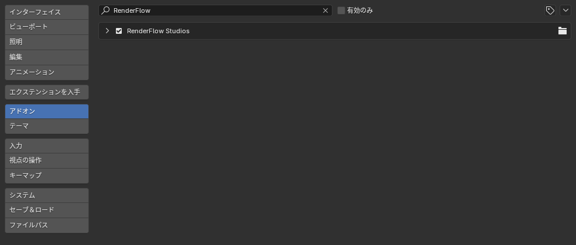
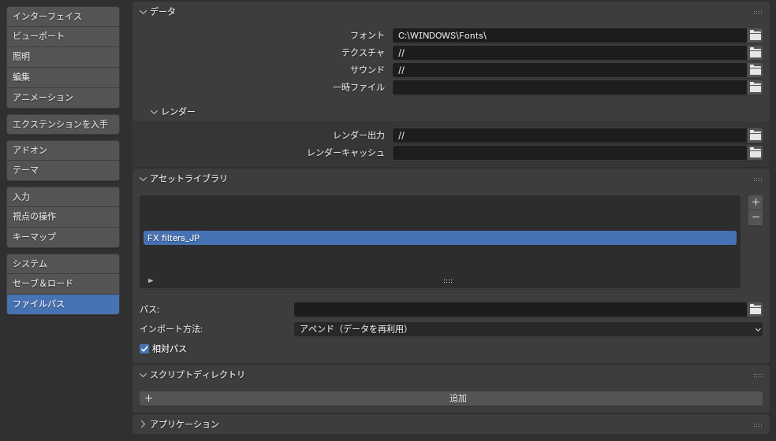

# インストール

## 1. ZIP ファイルをダウンロード

購入後に案内される URL から `RenderFlow_Studio_vX.X.X.zip` をダウンロードします。**ZIP は解凍せず**そのまま使用します。

## 2. Blender にインストール

1. Blender を起動し、++"Edit"++ → ++"Preferences"++（macOS は ++"Blender"++ → ++"Settings"++）を開きます。
2. 左のタブから **Add-ons** を選択します。
3. 右上の **∨** メニュー → **Install from Disk...** をクリックし、ダウンロードした ZIP を選択します。
4. 一覧に **RenderFlow Studios** が表示されるので、チェックボックスをオンにして有効化します。

{ .ui }

## 3. ライセンスを認証

有効化直後は、アドオンの設定欄にライセンス入力フォームだけが表示され、各パネルはまだ表示されません。
[ライセンス認証](activation.md) の手順でキーを登録すると、3D ビューのサイドバーに **RenderFlow Studios** タブが現れます。

## 4. FX フィルターのアセットライブラリを登録

コンポジットレイヤーの **FX フィルター**（Blur を除く 21 種）は、同梱の `FX_filters.blend` に入っているノードグループを Blender の**アセットライブラリ**経由で読み込みます。アドオンを有効化しただけでは登録されないため、一度だけ次の設定を行ってください。

1. 配布物の `FX filters assets` フォルダを任意の場所に置きます（`FX filters_JP` または `FX filters_US` のどちらか、UI 言語に合わせて選びます）。
2. ++"Edit"++ → ++"Preferences"++ → **File Paths** → **Asset Libraries** の **＋** をクリックし、そのフォルダを追加します。
3. ライブラリ名に **「FX」または「Filter」を含めます**（例：`RenderFlow FX`）。アドオンはこの名前で対象ライブラリを判別します。

{ .ui }

!!! warning "名前に FX / Filter が含まれていないと認識されません"
    巨大な素材ライブラリを誤って走査しないよう、名前で絞り込んでいます。登録後は **フィルターを追加** メニューに FX1〜FX5 のフィルターが表示されます。

## アップデート

1. Preferences > Add-ons で RenderFlow Studios を展開し、**Remove** で旧バージョンを削除します。
2. Blender を再起動します。
3. 新しい ZIP を上記の手順でインストールします。

!!! tip
    ライセンスキーは Blender の設定ファイルに保存されているため、アップデート後に再入力は不要です。

## アンインストール

Preferences > Add-ons で RenderFlow Studios を展開し、**Remove** をクリックします。
アドオンが保存したライセンスキャッシュも同時に削除されます。
