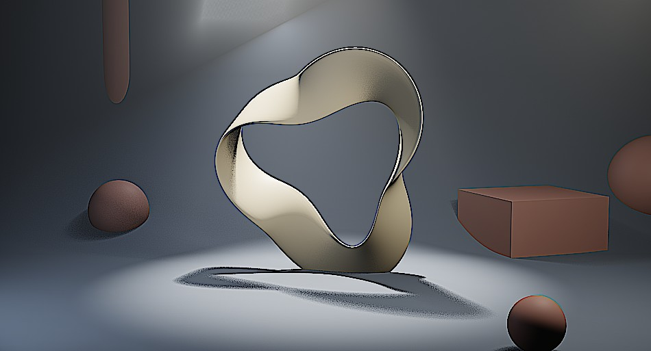

# Look プリセット一覧

**レイヤーを追加 → プリセットを追加** から選びます。複数のノードを直列に組んだノードグループが 1 枚のレイヤーとして追加され、Layer Properties から各ノードのパラメータを調整できます。各カードの左が適用前、右が適用後（サンプルシーンに既定値のまま 1 枚だけ追加してレンダリング）です。

## Look（色調）

<b>Cinematic (Teal / Orange)</b> — シャドウを青緑、ハイライトを橙に振る映画風の定番

<figure markdown="span">

<figcaption>適用前</figcaption>
</figure>
<figure markdown="span">

<figcaption>適用後</figcaption>
</figure>

構成: Color Balance（Lift 青緑 / Gain 橙）→ Hue/Saturation（彩度 1.12）

向いている用途: 映画風の全般、実写寄りの作品

<b>Warm Sunlight</b> — 暖色寄りのカラーバランス

<figure markdown="span">

<figcaption>適用前</figcaption>
</figure>
<figure markdown="span">

<figcaption>適用後</figcaption>
</figure>

構成: Color Balance（Gain を暖色 1.08 / 1.0 / 0.88 へ）

向いている用途: 夕景、回想シーン、やさしい雰囲気

<b>Cool Moonlight</b> — 寒色寄りのカラーバランス

<figure markdown="span">

<figcaption>適用前</figcaption>
</figure>
<figure markdown="span">

<figcaption>適用後</figcaption>
</figure>

構成: Color Balance（Gain を寒色 0.88 / 0.97 / 1.1 へ）

向いている用途: 夜景、SF、緊張感のある場面

<b>Vintage Film</b> — 黄味を足して彩度とコントラストを落とし、古いフィルムのように

<figure markdown="span">

<figcaption>適用前</figcaption>
</figure>
<figure markdown="span">

<figcaption>適用後</figcaption>
</figure>

構成: Color Balance（Lift / Gain を黄味に）→ Hue/Saturation（彩度 0.8）→ Bright/Contrast（Contrast −5）

向いている用途: 古い映像、記録映像風、回想

<b>Black & White</b> — モノクロ化

<figure markdown="span">

<figcaption>適用前</figcaption>
</figure>
<figure markdown="span">

<figcaption>適用後</figcaption>
</figure>

構成: Hue/Saturation（彩度 0）

向いている用途: 白黒作品、回想、ドラマチックな一枚

<b>High Contrast</b> — 明暗差を強調してグラフィカルに

<figure markdown="span">

<figcaption>適用前</figcaption>
</figure>
<figure markdown="span">

<figcaption>適用後</figcaption>
</figure>

構成: Bright/Contrast（Contrast +15）

向いている用途: グラフィカルな表現、ポスター風

## Filter（質感）

<b>Soft Glow</b> — 明部にやわらかいにじみ

<figure markdown="span">

<figcaption>適用前</figcaption>
</figure>
<figure markdown="span">

<figcaption>適用後</figcaption>
</figure>

構成: Glare（Fog Glow、品質 Medium）

向いている用途: ファンタジー、ドリーミーな場面

<b>Dream Blur</b> — 全体をふんわりとぼかす

<figure markdown="span">

<figcaption>適用前</figcaption>
</figure>
<figure markdown="span">

<figcaption>適用後</figcaption>
</figure>

構成: Blur（ガウス 8px）

向いている用途: 夢、記憶、回想の導入

<b>Sharpen</b> — 全体をシャープに

<figure markdown="span">

<figcaption>適用前</figcaption>
</figure>
<figure markdown="span">

<figcaption>適用後</figcaption>
</figure>

構成: Filter（Sharpen）

向いている用途: 仕上げの最後、縮小前の輪郭補強

!!! note
    Look プリセットは追加時点のノード構成をコピーしたものなので、あとから自由に編集できます。元に戻したい場合はレイヤーを削除して追加し直してください。
