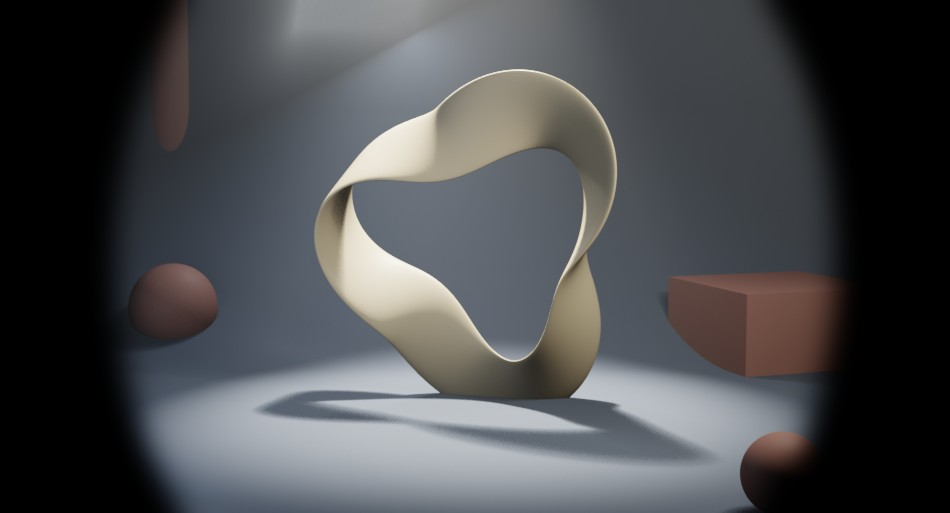
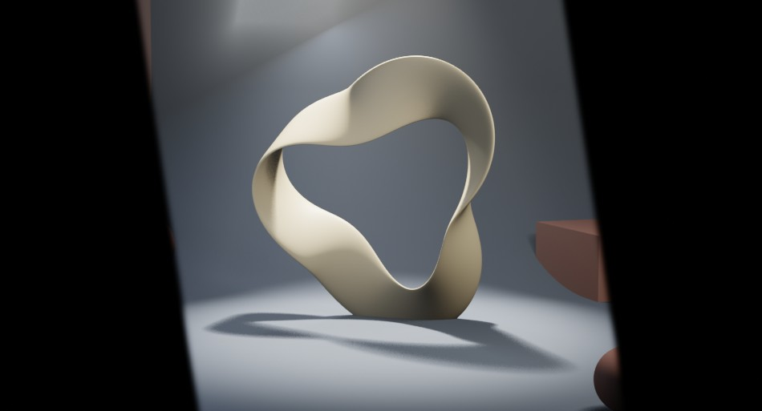
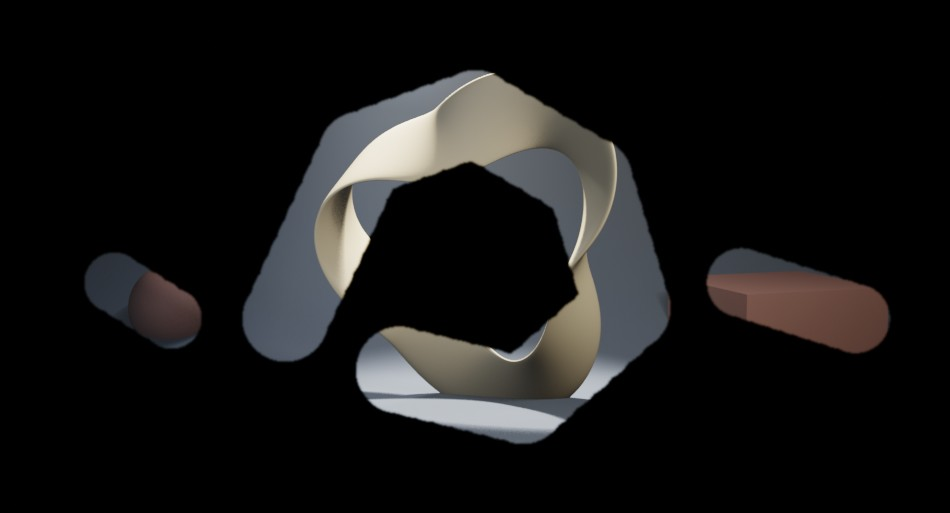
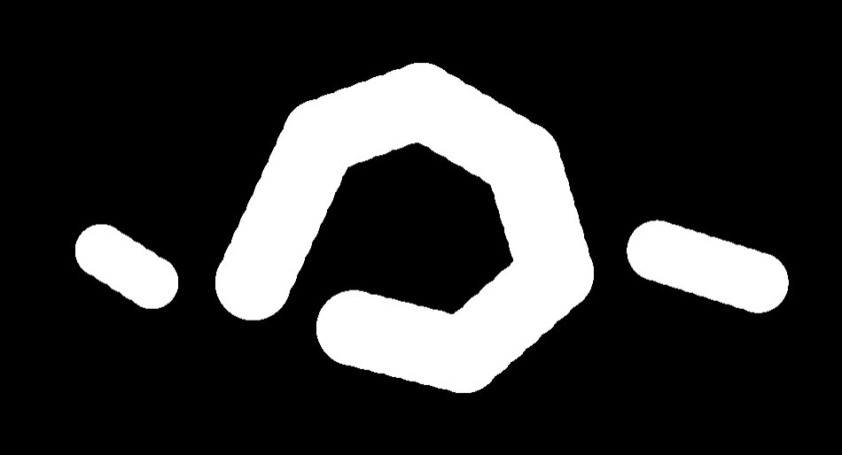
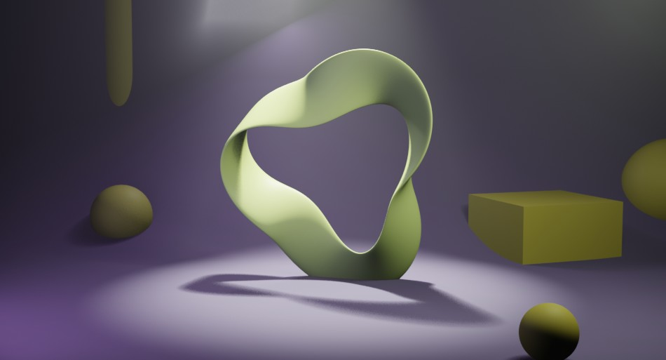
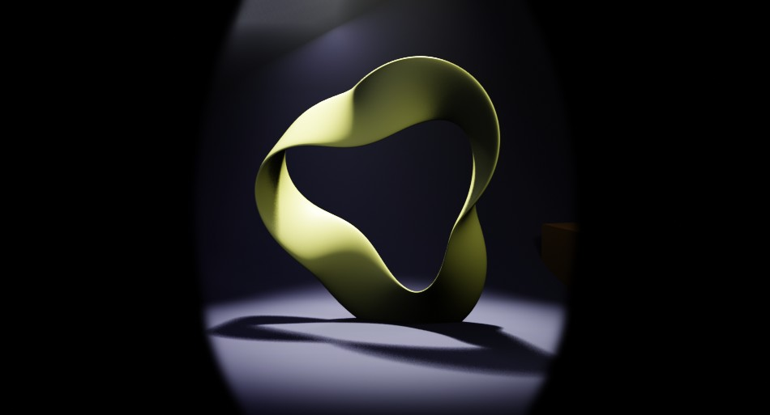

# マスクとクリッピング

画面の一部だけを残したり、効果のかかり方を範囲で変えたりするための機能です。各カードの左が適用前、右が適用後（サンプルシーンでレンダリング）です。

## マスクレイヤー

**レイヤーを追加 → マスクを追加** から選びます。マスクは **白 = 表示 / 黒 = 非表示** です。マスクレイヤーは既定で **乗算** ブレンドになっているため、追加するとそれより下の画像がマスクの白い範囲だけ残り、黒い範囲は黒くなります（ビネットや切り抜きとして使えます）。エッジの柔らかさは Layer Properties の **マスクぼかし** で調整します。

<div class="fx-card" markdown>
<div class="fx-title"><b>楕円マスク</b> — 楕円形の範囲だけを残す</div>
<div class="fx-pair" markdown>
<figure markdown="span">

<figcaption>適用前</figcaption>
</figure>
<figure markdown="span">

<figcaption>適用後</figcaption>
</figure>
</div>
<div class="fx-params">Blender ノード: Ellipse Mask</div>
<div class="fx-params">パラメータ: 幅、高さ、回転、マスクぼかし</div>
<div class="fx-params">比較の設定: 幅 0.75 / 高さ 0.9 / マスクぼかし 40</div>
</div>

<div class="fx-card" markdown>
<div class="fx-title"><b>ボックスマスク</b> — 矩形の範囲だけを残す</div>
<div class="fx-pair" markdown>
<figure markdown="span">

<figcaption>適用前</figcaption>
</figure>
<figure markdown="span">

<figcaption>適用後</figcaption>
</figure>
</div>
<div class="fx-params">Blender ノード: Box Mask</div>
<div class="fx-params">パラメータ: 幅、高さ、回転、マスクぼかし</div>
<div class="fx-params">比較の設定: 幅 0.55 / 高さ 0.7 / 回転 0.15 / マスクぼかし 10</div>
</div>

<div class="fx-card" markdown>
<div class="fx-title"><b>ダブルエッジマスク</b> — 内側と外側の 2 つのマスクから縁取り（エッジ）を作る</div>
<div class="fx-pair" markdown>
<figure markdown="span">

<figcaption>適用前</figcaption>
</figure>
<figure markdown="span">

<figcaption>適用後</figcaption>
</figure>
</div>
<div class="fx-params">Blender ノード: Double Edge Mask</div>
<div class="fx-params">パラメータ: 内側（Inner Mode）、エッジ（Edge Mode）、内側マスク入力、外側マスク入力</div>
<div class="fx-params">比較の設定: 内側 = ALL / エッジ = BLEED_OUT。小さい楕円マスクを内側、大きい楕円マスクを外側にノードエディタで接続</div>
</div>

!!! note "ダブルエッジマスクについて"
    ダブルエッジマスクは **内側マスク** と **外側マスク** の 2 つの入力から縁取りを作るノードです。追加した直後は入力が揃っていないため真っ黒になります。ノードエディタで内側・外側にそれぞれマスクノード（楕円マスクなど）を接続してから使ってください。

<div class="fx-card" markdown>
<div class="fx-title"><b>ペイントマスク</b> — 画像に白く塗った範囲だけを残す</div>
<div class="fx-pair" markdown>
<figure markdown="span">

<figcaption>適用前</figcaption>
</figure>
<figure markdown="span">

<figcaption>適用後</figcaption>
</figure>
</div>
<div class="fx-params">Blender ノード: Image（黒で初期化したマスク画像）</div>
<div class="fx-params">パラメータ: ブラシ（画像エディタでペイント）、マスクぼかし</div>
<div class="fx-params">比較の設定: 白ブラシでリボンの周りをなぞり、小物に 2 か所ダブ / マスクぼかし 3</div>
</div>

上の例で塗ったマスク画像です。白い部分だけが残り、黒い部分は黒くなります。

{ .ui }

### ペイントマスクの手順

1. **マスクを追加 → ペイントマスク** を選びます。マスク用の画像（黒で初期化）が自動生成されます。
2. **マスクをペイント** ボタンを押すと、画像エディタがペイントモードで開きます。
3. 白いブラシで残したい範囲を塗ります。
4. 画像エディタのサイドバー **RenderFlow Studios** タブにある **コンポジットへ戻る** でコンポジターに戻ります。

!!! warning "解像度％を変えると位置がずれます"
    ペイントマスク用の画像は、追加した時点の **レンダー解像度（100%）** で作成されます。解像度％を下げてレンダリングすると画像の中央部分だけが切り出され、塗った位置がずれます。ペイントマスクを使うときは、追加したときと同じ解像度設定でレンダリングしてください。

!!! warning "ペイントマスクの保存"
    ペイントした画像は `.blend` に内包（Pack）されます。外部ファイルとして保存したい場合は画像エディタの Image > Save As を使ってください。

## クリッピング

Layer Properties の **Clip to Below（クリッピング）** を ON にすると、そのレイヤーのブレンドが **乗算** に固定されます。効果レイヤーの結果が下の画像と掛け合わされるため、**下の画像が明るい部分ほど効果が強く、暗い部分（マスクの黒い範囲など）にはほとんど効かなくなります**。マスクレイヤーの上に置くことで、マスクで残した範囲にだけ効果を集中させる近似として使えます。

```
┌ 調整レイヤー（クリッピング ON）   ← 乗算で合成される
└ 楕円マスク                        ← 白い範囲だけを残す
  シーン（レンダーレイヤー）
```

<div class="fx-card" markdown>
<div class="fx-title"><b>クリッピング OFF</b> — 色相 / 彩度 レイヤーをそのまま重ねた状態</div>
<div class="fx-pair" markdown>
<figure markdown="span">

<figcaption>適用前</figcaption>
</figure>
<figure markdown="span">

<figcaption>適用後</figcaption>
</figure>
</div>
<div class="fx-params">レイヤー構成: 色相 / 彩度（Clip to Below OFF）</div>
<div class="fx-params">比較の設定: Hue 0.62 / Saturation 1.4</div>
</div>

<div class="fx-card" markdown>
<div class="fx-title"><b>クリッピング ON</b> — 同じレイヤーを乗算で合成した状態</div>
<div class="fx-pair" markdown>
<figure markdown="span">

<figcaption>適用前</figcaption>
</figure>
<figure markdown="span">

<figcaption>適用後</figcaption>
</figure>
</div>
<div class="fx-params">レイヤー構成: 色相 / 彩度（Clip to Below ON）</div>
<div class="fx-params">比較の設定: Hue 0.62 / Saturation 1.4</div>
</div>

<div class="fx-card" markdown>
<div class="fx-title"><b>楕円マスク ＋ クリッピング ON</b> — マスクで残した範囲に効果が集中する</div>
<div class="fx-pair" markdown>
<figure markdown="span">

<figcaption>適用前</figcaption>
</figure>
<figure markdown="span">

<figcaption>適用後</figcaption>
</figure>
</div>
<div class="fx-params">レイヤー構成: 楕円マスク の上に 色相 / 彩度（Clip to Below ON）</div>
<div class="fx-params">比較の設定: 楕円マスク 幅 0.5 / 高さ 0.8 / ぼかし 20、Hue 0.62 / Saturation 1.4</div>
</div>

!!! tip "効果を一部だけに弱くかけたいとき"
    クリッピングは乗算による近似なので、暗くなりすぎる場合は効果レイヤーの **不透明度** を下げて調整してください。
