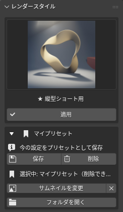
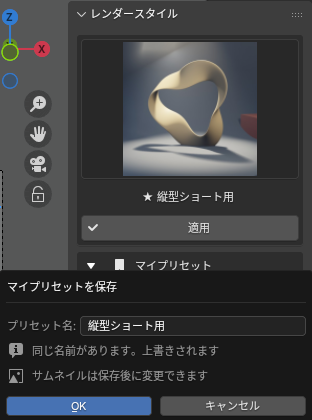
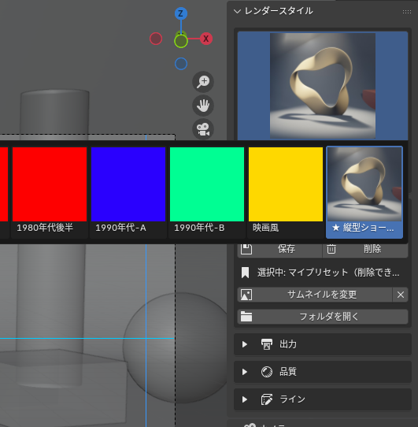
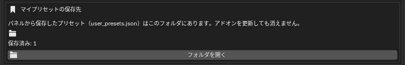

# マイプリセット

標準プリセット（80年代〜映画風）を適用したあとに解像度や fps などを自分好みに変えた状態を、**名前を付けて保存**しておける機能です。保存したプリセットは標準プリセットと同じサムネイルグリッドに **★ 付き**で並び、いつもの **適用** ボタンで呼び出せます。JSON ファイルを編集する必要はありません。

{ .ui }

## 保存する

1. レンダースタイルの各項目（出力・品質・ライン）やカメラのセーフエリアを好みの値にします。標準プリセットを **適用** してから一部だけ変えるのが簡単です。
2. **レンダースタイル** パネルの **マイプリセット** を開き、**保存** を押します。
3. 名前を入力して **OK** を押します。

{ .ui }

保存が終わると、グリッドに ★ 付きの新しいサムネイルが追加され、そのプリセットが選択された状態になります。サムネイルは最初は共通のしおりアイコンです（次の「サムネイルを設定する」で好きな画像に変えられます）。

!!! tip "上書き保存"
    すでにある名前を付けて保存すると、そのプリセットが今の設定で上書きされます。ダイアログに「同じ名前があります」と表示されるので確認してください。

## サムネイルを設定する

保存したプリセットには、好きな画像をサムネイルとして登録できます。レンダリング結果の画像を使うと、グリッドを見ただけでどんな見た目になるか分かるのでおすすめです。

1. グリッドで ★ 付きのプリセットを選びます。
2. **マイプリセット** の **サムネイルを変更** を押します。
3. ファイルブラウザで画像（PNG / JPG / WebP など）を選び、**開く** を押します。

画像は中央で正方形に切り抜かれ、256 px に縮小してプリセットの保存先へコピーされます。元の画像をあとで移動・削除しても影響しません。右隣の **×** を押すと共通のしおりアイコンに戻ります。

{ .ui }

## 読み込む（適用する）

グリッドで ★ 付きのサムネイルを選び、**適用** を押します。標準プリセットとまったく同じ操作です。適用されるのは保存時と同じ項目（下の表）で、カメラの位置やオブジェクトには影響しません。

## 削除する

1. グリッドで削除したい ★ 付きのプリセットを選びます。
2. **マイプリセット** の **削除** を押し、確認ダイアログで OK を押します。

**削除** ボタンは自分で保存したプリセットを選んでいるときだけ押せます。標準プリセットは削除・上書きされません。

## 保存される項目

| 区分 | 項目 |
|---|---|
| 出力 | 解像度 X / Y、解像度 %、フレームレート（FPS / ベース）、カラーマネージメント（ビュー変換・Look） |
| 品質 | レンダーエンジン、サンプル数（レンダー / ビューポート）、フィルターサイズ、ソフトシャドウ、ライティング（バウンス、コースティクス、影のレイ数 / ステップ / 解像度）、ボリューム（タイルサイズ、サンプル、分布、影、ステップレート、最大ステップ、バウンス） |
| ライン | FreeStyle の ON / OFF |
| カメラ | セーフエリアの余白（px）、透視 / 平行投影、クリップ開始 / 終了、被写界深度の ON / OFF |

## 保存先とバックアップ

プリセットは Blender のユーザー設定フォルダに `user_presets.json` として保存され、サムネイル画像は同じ場所の `icons/` に入ります。**アドオンを更新（ZIP を入れ直し）しても消えません。** パネルの **フォルダを開く**、またはプリファレンス（編集 > プリファレンス > アドオン > RenderFlow Studios）の **マイプリセットの保存先** にある **フォルダを開く** を押すと保存先が開くので、`user_presets.json` と `icons/` をコピーすればバックアップや別の PC への引き継ぎができます。

{ .ui }

プリファレンス側には保存先のパスと保存済みの件数も表示されます。ライセンス認証前や認証が切れているときでも、ここからフォルダを開いてバックアップを取り出せます。

```
（Windows の例）
C:\Users\<ユーザー名>\AppData\Roaming\Blender Foundation\Blender\4.5\config\RenderFlow_Studios\user_presets.json
```

!!! note "Blender のバージョンを上げたとき"
    保存先はバージョンごとのフォルダなので、新しいバージョンには自動では引き継がれません。上のファイルを新しいバージョンの同じ場所へコピーしてください。
