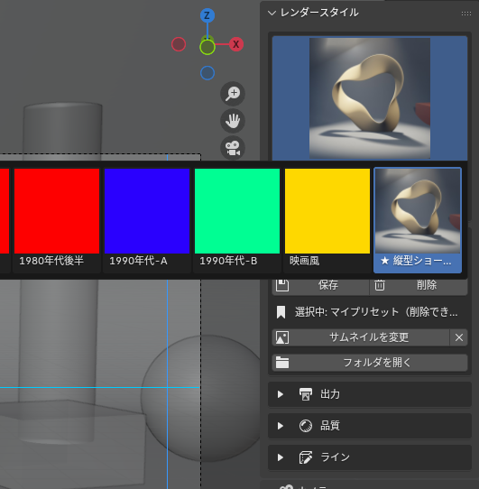
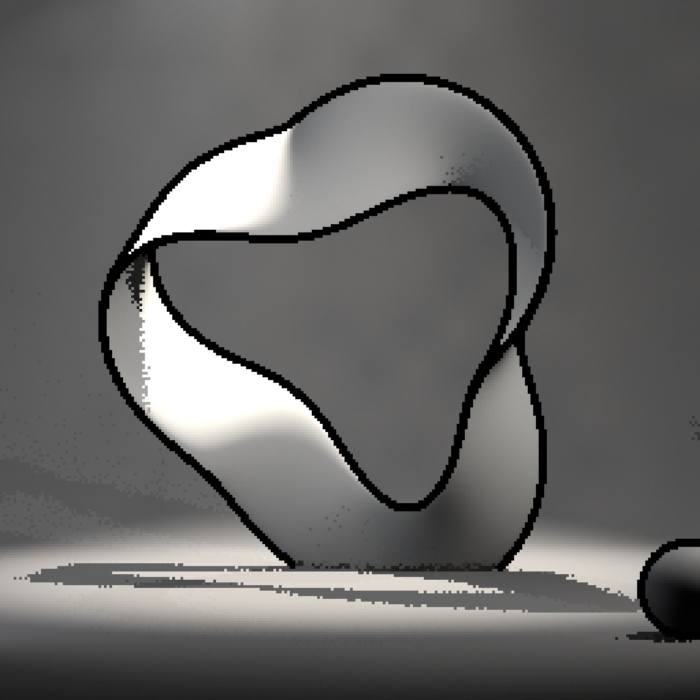
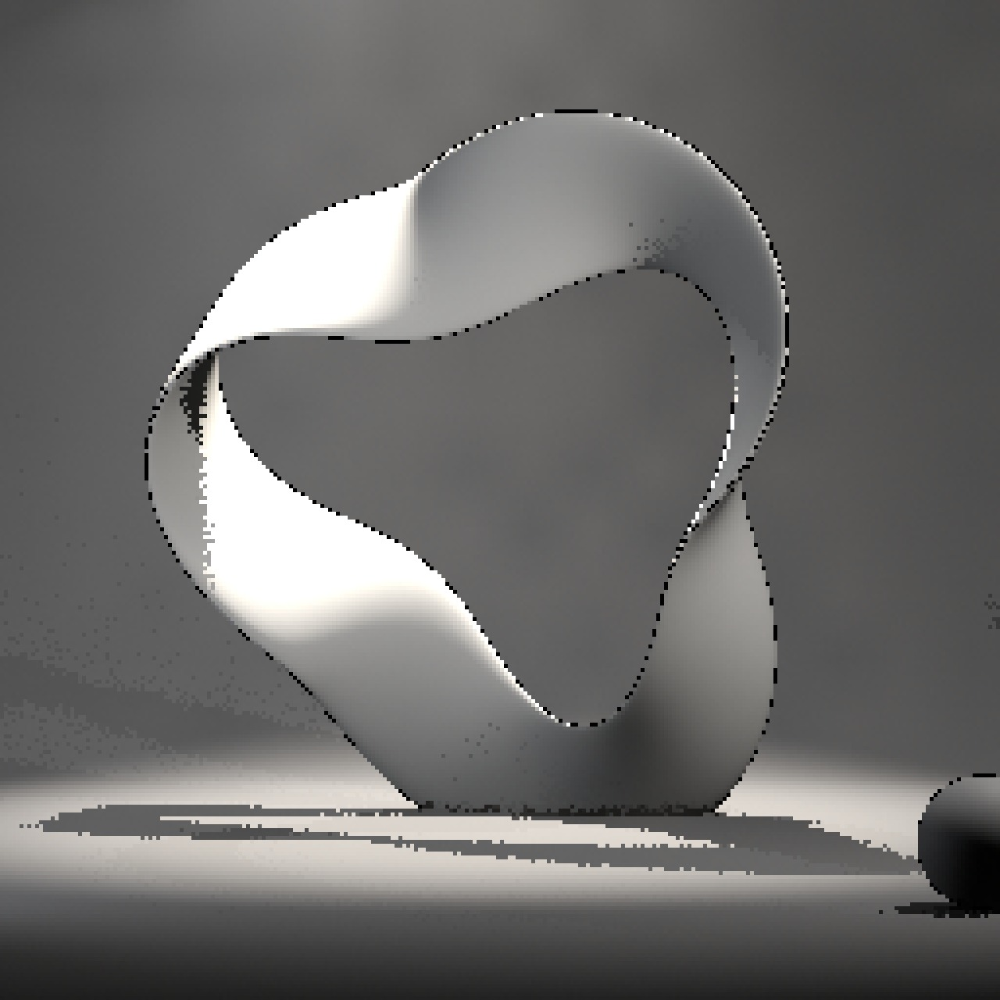
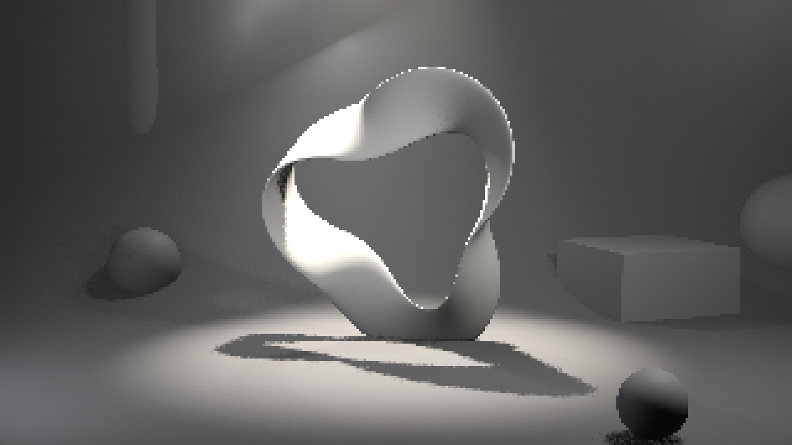
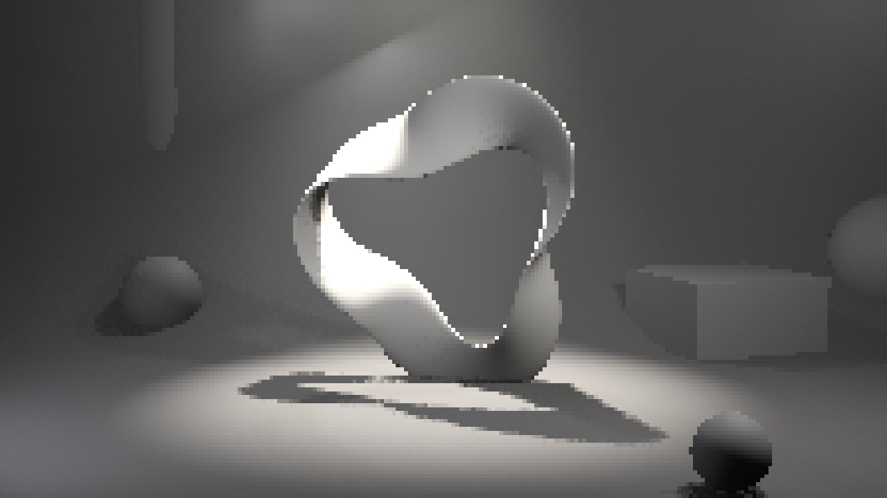
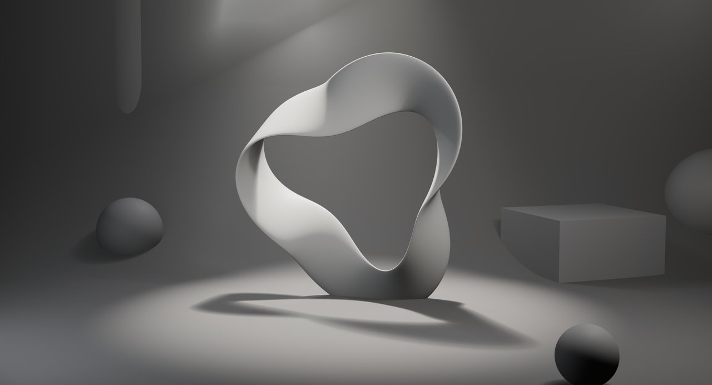
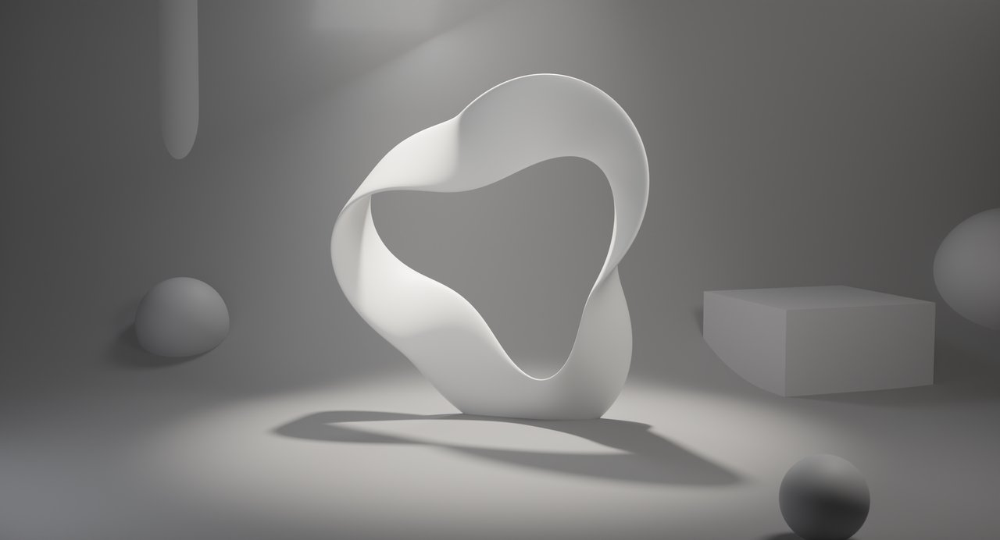

# レンダースタイル

3D ビューポートのサイドバー → **RenderFlow Studios** タブ → **レンダースタイル** パネル。

{ .ui }

## プリセットの選択と適用

サムネイルをクリックすると標準プリセットと、自分で保存した ★ 付きの [マイプリセット](my_presets.md) が並びます。

1. アイコングリッドから使いたいスタイルをクリックします（選択中の名前がグリッドの下に表示されます）。
2. **✓ 適用** を押すと、下表の項目がシーンとアクティブカメラに書き込まれます。

適用前の設定は保持されないため、必要であれば事前に `.blend` を保存してください。

!!! tip "自分の設定を保存する"
    適用後に変更した設定は [マイプリセット](my_presets.md) から名前を付けて保存し、標準プリセットと同じグリッドから呼び出せます。

## 標準プリセット一覧

各プリセットの **適用前**（Blender 初期設定：EEVEE・AgX・64 サンプル、解像度のみプリセットと同じ）と **適用後** の比較です。サンプルシーンには霧のボリュームと、それを横切るスポットライトの光条を入れてあり、ボリュームと影の品質設定の違いが光の帯と影の縁に現れます。低解像度のプリセットは拡大表示のため、ドットがそのまま見えます。

<b>1980年代前半</b> — EEVEE / 256×256 / 15fps

<figure markdown="span">

<figcaption>適用前（Blender 初期設定）</figcaption>
</figure>
<figure markdown="span">

<figcaption>適用後</figcaption>
</figure>

平行投影・1 サンプル・FreeStyle 輪郭線・Standard。ドット絵の質感

<b>1980年代後半</b> — EEVEE / 2560×2560 (10%) / 15fps

<figure markdown="span">

<figcaption>適用前（Blender 初期設定）</figcaption>
</figure>
<figure markdown="span">

<figcaption>適用後</figcaption>
</figure>

同じ絵づくりを高解像度データで持ち、10% 縮小でドット化

<b>1990年代-A</b> — EEVEE / 320×180 / 30fps

<figure markdown="span">

<figcaption>適用前（Blender 初期設定）</figcaption>
</figure>
<figure markdown="span">

<figcaption>適用後</figcaption>
</figure>

透視投影・8 サンプル。据え置き機のローポリ 3D 風

<b>1990年代-B</b> — EEVEE / 224×126 / 30fps

<figure markdown="span">

<figcaption>適用前（Blender 初期設定）</figcaption>
</figure>
<figure markdown="span">

<figcaption>適用後</figcaption>
</figure>

フィルターサイズ 0.01 でエッジがシャープな携帯機風

<b>映画風</b> — Cycles / 2880×1557 / 24fps

<figure markdown="span">

<figcaption>適用前（Blender 初期設定）</figcaption>
</figure>
<figure markdown="span">

<figcaption>適用後</figcaption>
</figure>

512 サンプル・Filmic（Medium High Contrast）・被写界深度・高品質ボリューム

## 適用で書き換わる項目

| 分類 | 項目 |
|---|---|
| 出力 | 解像度 X / Y / %、フレームレート、ビュー変換（Standard / Filmic / AgX）と Look（コントラスト） |
| 品質 | レンダーエンジン、レンダー / ビューポートサンプル、フィルターサイズ、ソフトシャドウ（EEVEE）、ライティング（EEVEE の影のレイ数 / ステップ数 / 解像度、Cycles のバウンス数とコースティクス）、ボリューム設定 |
| ライン | FreeStyle の ON / OFF |
| カメラ | 投影方式（透視 / 平行）、クリップ開始 / 終了、被写界深度の ON / OFF、**セーフエリア余白** |

!!! note "カメラ関連の項目"
    カメラ関連はシーンのアクティブカメラ（`Scene > Camera`）に書き込まれます。カメラが未設定のシーンでは、カメラ項目はスキップされます。

## 出力・品質・ライン セクション

適用ボタンの下にある 3 つの折りたたみは、プリセット適用後の値を確認・微調整するための場所です。Blender 標準のプロパティを直接編集しているので、ここでの変更はレンダープロパティにもそのまま反映されます。

### 出力
- **解像度 X / Y / %**
- **フレームレート**：FPS とベース
- **ビュー変換**：カラーマネジメントのビュー変換

### 品質
- **レンダーエンジン**
- **サンプル**：レンダー / ビューポート（Cycles は `samples` / `preview_samples`、EEVEE は TAA サンプル）
- **フィルターサイズ (px)**：小さいほどシャープ。レトロ系は 0.01〜0.2、映画風は 1.5
- **ソフトシャドウ**：EEVEE のみ表示
- **ライティング**（折りたたみ）：EEVEE は影のレイ数 / ステップ数 / 解像度、Cycles は最大 / ディフューズ / 光沢バウンスとコースティクス
- **ボリューム**（折りたたみ）：エンジンに応じて EEVEE のタイルサイズ / サンプル / 影、または Cycles のステップレート / 最大ステップ / バウンスを表示

### ライン
- **FreeStyle**：ON にすると線幅モード（絶対値 / 相対値）と線幅が表示されます
